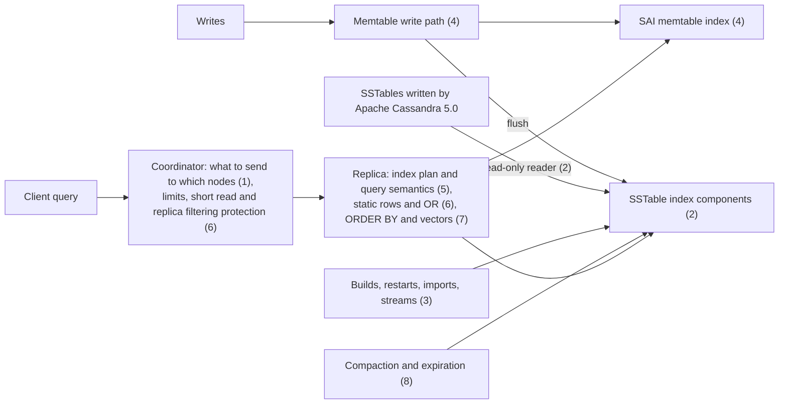
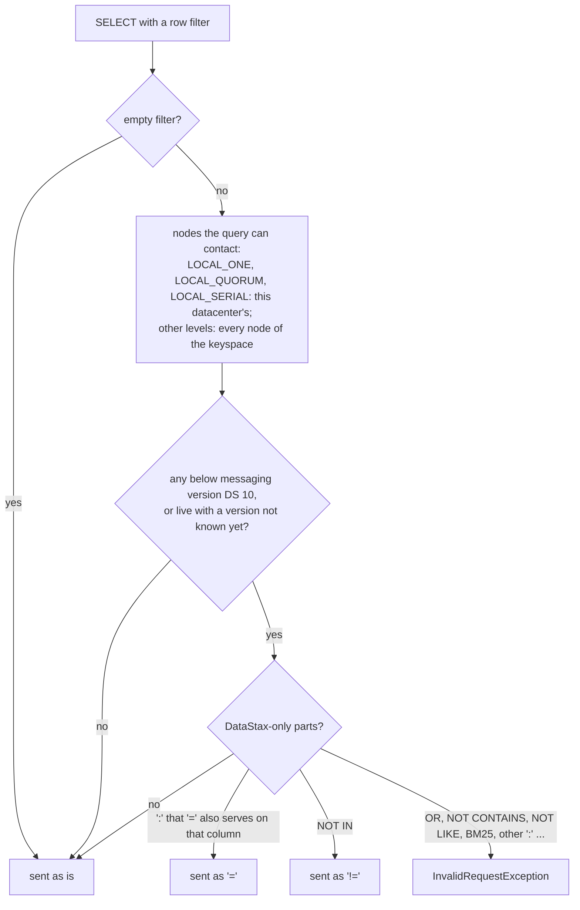
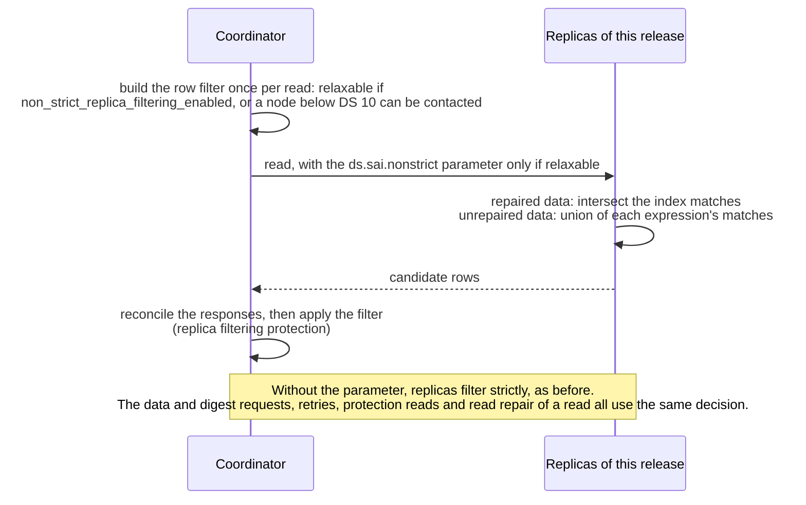
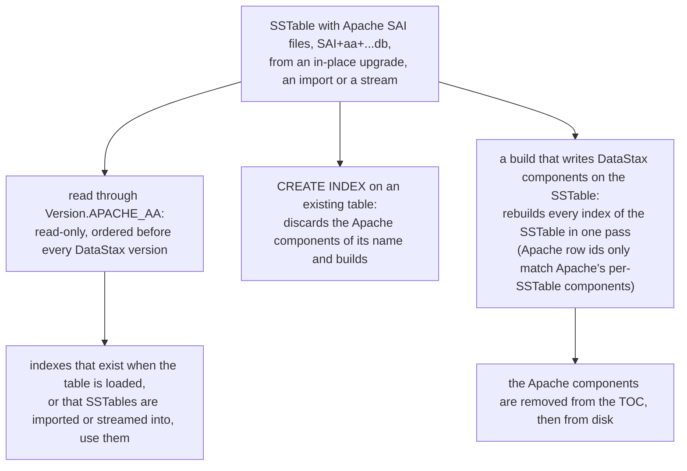
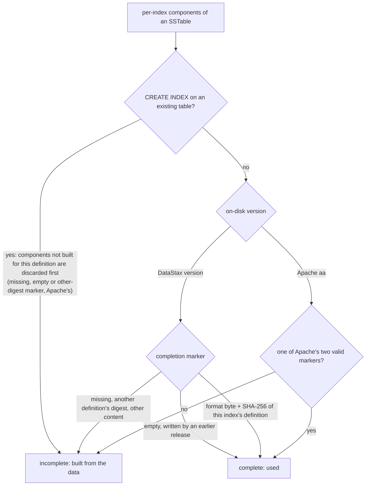
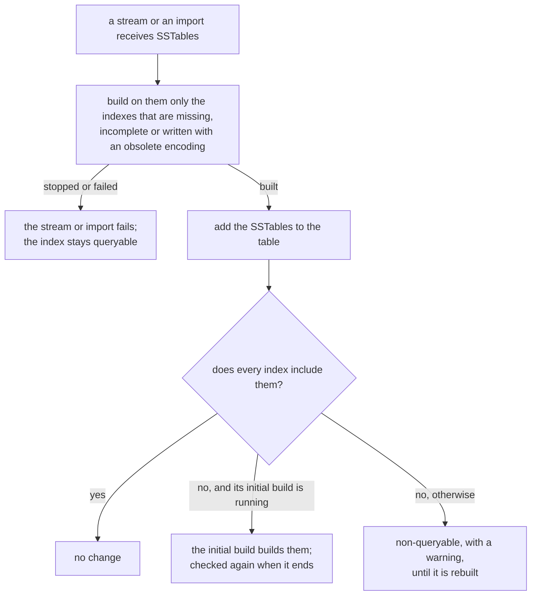
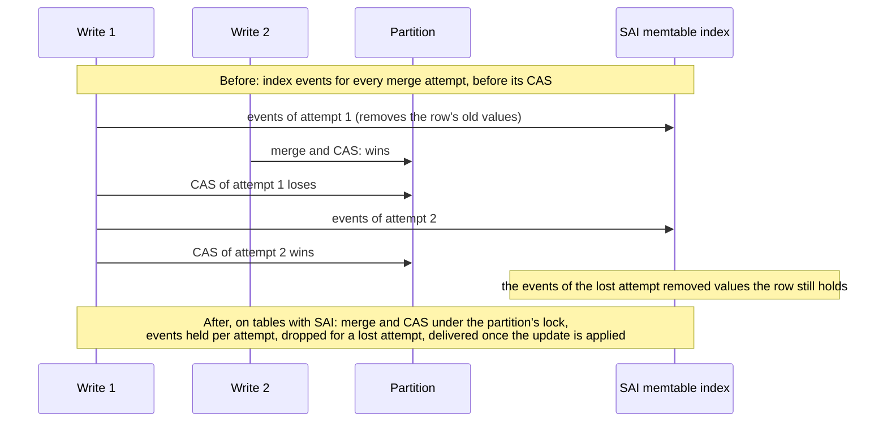

# Review guide: Apache SAI fixes restored on DataStax main-5.0

*Read it as a web page: <https://jeremiahdjordan.github.io/ai-review-guides/sai-apache-ports/>*

This guide is for reviewers, human or AI, of the commits that bring Apache Cassandra's Storage-Attached Index (SAI)
fixes into DataStax's Cassandra 5.0 line. It says what the commits are, where to start, what each group of commits
changes, and what to check in each. The [audit report](https://jeremiahdjordan.github.io/ai-review-guides/sai-apache-ports/audit-report.html) has the full classification of every Apache
SAI commit, the test evidence and the bugs filed along the way.

## The change under review

- **Branch:** `main-5.0-fb7f1b7aee-merge` (mainline in this guide): DataStax's 5.0 line (main-5.0, branch `main` of
  datastax/cassandra) merged with Apache `cassandra-5.0` at `fb7f1b7aee`. The branch isn't published, so the commit IDs below can't
  be opened on GitHub; reviewers need access to the branch, and this guide doesn't publish the code. Its history has
  been rewritten before; if an ID doesn't resolve, find the commit by its subject.
- **Commits:** 106 commits, `git log --reverse fa5d580418e..ae493d880df`, plus `1d5c08a0ffb` (return only the selected
  static columns from a trie memtable partition read with no slice), which landed earlier. Every commit is
  `CNDB-XXX: 
`, by Jeremiah Jordan except the CNDB-19682 cherry-pick (`572931a4f9b`, by its original author).
- **Size:** about 64,000 added lines, three quarters of them tests. The biggest commits are the reader of Apache-written
  SAI files (`5e60c1c499a`, +8,941), non-strict replica filtering (`017d9e35c59`, +5,834) and the static-row and row
  numbering fix (`925eff0c75d`, +4,124).
- **State:** the series passed a private test runner on JDK 11 with 0 failures (see [Evidence](#evidence)).

## Background in four points

1. DataStax built SAI for DSE 6.8 and contributed it to Apache as CEP-7. Apache Cassandra 5.0 then shipped its own
   implementation with its own on-disk format, also called `aa`.
2. DataStax's tree has carried its own SAI since 2021 (STAR-121); on the 5.0 line that commit replaces Apache's SAI.
   Each later Apache SAI fix reached DataStax only by a hand port, and most never got one.
3. The audit checked all 220 Apache `cassandra-5.0` and `trunk` SAI commits against DataStax main-5.0 by behaviour:
   34 are restored by these commits, 120 were already present or equivalent, 57 don't apply, 4 are kept as
   documented deviations and 5 are deferred.
4. Many commits fix DataStax-only bugs in the same code. The restored fixes and their tests depend on them.

## How to read a commit

- **The message is the specification.** Each message says what was wrong, why, and what changed, with a reproducer
  in plain CQL where there is one. Check the code against the message, then the message against the code: a
  behaviour the code changes that the message doesn't mention is a finding.
- **Provenance lines** at the end of a message name the upstream source:
  `Adapted from CASSANDRA-NNNNN (apache/cassandra commit <sha>).` for ported code,
  `Tests adopted from CASSANDRA-NNNNN (...)` for ported tests, and `(cherry picked from commit <sha>)` for an
  unchanged pick. Compare an adapted commit with its Apache commit: the differences should be what this SAI's code
  needs, not a different fix.
- **One complete fix per commit.** Each commit builds, passes its own tests, and doesn't need a later commit to be
  correct. A later commit that changes an earlier one's code says so in its message.
- **NEWS.txt** gets an entry for every change an operator can see: new settings, changed results, upgrade steps.
  Check that the entry exists and that it matches the code.

## Where to start

Review the commits with compatibility or concurrency impact first. A bug in these is hard to undo once released:

| Commit | Why it matters | Check first |
|---|---|---|
| `59001b61e92` Reject DataStax-only row filter features in queries that can reach Apache Cassandra nodes | Decides which queries are refused in a mixed cluster | Which nodes a query "can reach" per consistency level; the cache of the peer check and every event that invalidates it; that `:` is sent as `=` only where that is the same query |
| `331dd77ba02` Support LIKE restrictions in filtering queries | Introduces messaging version DS 21 (111), announced but not used for serialization | Every place that compares versions: schema pull and push, `PrepareMessage`, `Batch`, serialized-size caches. Downgrade: is anything written in DS 21? |
| `744cd7cf376` Support blob columns in SAI indexes | `CREATE INDEX` gated on every peer's version | Unknown and down peers count; the `new_feature_peer_version_check: none` opt-out |
| `017d9e35c59` Relax SAI intersections on replicas when the coordinator enables non-strict filtering | Changes what replicas return and what the coordinator reconciles | The decision is made once per read and kept by every copy of the filter (digest, speculative retry, short-read and replica-filtering protection, read repair); the `ds.sai.nonstrict` message parameter |
| `5e60c1c499a` Read the SAI indexes written by Apache Cassandra 5.0 | New read-only on-disk version `aa(apache)` | Byte order, CRC32C checksums, key encoding, the block-balanced tree reader, jvector graph compatibility; that nothing ever writes this version; the `cassandra.sai.read_apache_format=false` switch |
| `995d2963296` Don't let a new SAI index adopt stale components of a same-name index | Changes the completion marker's content | Legacy empty markers stay valid; the bounded marker read; older binaries only check existence |
| `925eff0c75d` Index static rows on partition key components, and number SAI rows alike in every build | Changes row numbering in builds | Components written by earlier releases keep working; a mismatch in row counts fails the build rather than misreading |
| `0235c5d3984` Apply SAI updates to skip-list memtables atomically, so racing writes keep index entries | Serializes writes per partition on tables with SAI | Lock scope; no lock on tables without SAI; bookkeeping of an applied update when the index transaction fails |
| `ca4909363c8` Accept partition keys that share a token in SAI version GA, and look them up by key | Primary key map lookups on every version | Exact, ceiling and floor lookups for keys sharing a token, per map type and version |
| `998ea989cb5` Index map entries, frozen values and varints in canonical form in SAI | New term encoding for some values | Old indexes are still searched with values as written; size checks use the canonical size |
| `817347ca894` Fail a read that only an unknown index can serve as an index not available | Read path on replicas that don't know an index yet | Every case that leaves the command without an index plan; the client sees "index not available", not an internal error |

## The commits by area

The [appendix](#appendix-every-commit) lists all 107 commits in branch order with their sources and tests. The
same commits by area, with the area numbers showing where each area acts:

### 1. Mixed clusters with Apache Cassandra 5.0 nodes

`59001b61e92`, `331dd77ba02`, `744cd7cf376`, `017d9e35c59` (with `c527cfcaffb`, CASSANDRA-20189), `a23830ebd5d`
(CASSANDRA-21700), `817347ca894`.

A DataStax 5.0 cluster can contain Apache Cassandra 5.0 nodes during a migration. Apache Cassandra 5.0 nodes are on
messaging version 13; DataStax nodes are on DS 10 (100) or later. These commits decide what a
DataStax node sends to them and what it refuses.

A query whose filter has parts that only DataStax nodes can read (`59001b61e92`):

The result of the node check is cached per keyspace and scope until a messaging version, gossip state, liveness,
peer, token metadata or keyspace replication changes. A node not counted yet is still protected: the serializers
refuse these parts for a node below DS 10, and the request fails at once. LIKE has its own check, at DS 21
(`331dd77ba02`).

Non-strict replica filtering (`017d9e35c59`), for a row whose restricted columns were written to different
replicas:

Ordered queries, ONE and LOCAL_ONE, single-replica keyspaces and filters on one mutable column stay strict. A strict
filter is never sent to a node below DS 10, which would relax it: the serializer refuses it, and the coordinator
reads the query or page once more with a filter that replicas can relax.

Check:
- Decisions about what to send use the **messaging version** only, never a release version. A peer below DS 10 is an
  Apache Cassandra node (or a DataStax node pinned to Apache's version).
- Node and peer metadata comes from `org.apache.cassandra.nodes`, which DataStax deployments can replace with their
  own implementation.
- A refused query gets an `InvalidRequestException` that says why, not a wrong result from the Apache node.
- The read after a refused strict filter happens once, with new selectors, and doesn't repeat warnings.
- Tests: the in-JVM dtests of these commits (`DataStaxOnlyRowFilterDistributedTest`, `LikeAcrossDatacentersTest`,
  `BlobIndexDistributedTest`) cover peers on older messaging versions.

### 2. On-disk formats

`5e60c1c499a` (Apache reader), `72911dd398b` (vector checksums, CASSANDRA-21516), `ca4909363c8` (token collisions at
GA), `998ea989cb5` (canonical terms), `5d22616e371` (DESC inet, varint and decimal clustering columns,
CASSANDRA-20100),
`820800c8532` and `ac2d89aeea3` (behaviour before versions DC and DB), `95a19f32a62` (rewrite corrupt per-SSTable
components, CASSANDRA-18490).

Check:
- No commit changes what an existing on-disk version writes, except where the message says so and gives the
  compatibility rule. A new behaviour that depends on the format is gated on the SAI version.
- Readers of older versions stay correct: the tests include SSTables written by earlier releases and by Apache
  Cassandra 5.0 (`test/data/...`), loaded and queried.
- `95a19f32a62` is on by default (`cassandra.sai.validate_per_sstable_checksum_on_partial_build`), as in Apache
  Cassandra; it adds reads to partial builds.

How SSTables with Apache Cassandra's SAI files are used (`5e60c1c499a`):

### 3. Index lifecycle: builds, restarts, imports and streams

`60cfffb636a`, `039862defa6` (CASSANDRA-20732), `904759d3a01`, `995d2963296`, `c8e58e04874`, `7ca866b71d4`,
`af4e52a0c11`, `2cb2f35aefb`, `e8a4b150529`, `1ae87c2c71a`, `041930d6280`, `ececdb3a126`, `4f5df98f6e3`,
`1ea565c5b31` (CASSANDRA-21671), `ae493d880df`, `5ac6f62ee4f` (CASSANDRA-19987), `ac17666cdb8` (writer abort
logging, CASSANDRA-20695).

These decide when an index is queryable. The rule they all serve: an index is queryable only when every live SSTable
has complete, correct components for it.

When the per-index components of an SSTable count as complete (`995d2963296`, `5e60c1c499a`, changed by
`925eff0c75d`):

SSTables added by a stream or an import (`c8e58e04874`):

Check:
- Every path that makes an index queryable (initial build, rebuild, restart, import, stream, truncate) checks the
  live SSTables, not a snapshot taken before the build.
- A failed or stopped build leaves the index non-queryable, or fails only the stream or import, as the message says.
- Ownership and locks: who may write or delete an SSTable's component files while another build runs, and that a
  dropped index's build can't change the state of a new index of the same name.
- Races are tested by pausing threads at chosen calls with `inject.Injections` (Byteman). Check that each test
  asserts that its pause was reached: a pause on a call that no longer happens passes without testing anything.

### 4. Memtables and the write path

Trie memtables: `1d5c08a0ffb`, `6aea1e383fa`, `fcb65f1ab87`, `572931a4f9b` and `a6b52517ff5` (CNDB-19682),
`ce4eebbd4f1`, `d4a5fc7aa74` (CNDB-19681), `ecd92655eec`.
SAI memtable index: `ede0074ea84`, `3db4c8633e2`, `e630511ed8c`, `fbc982440ee`, `325279bbb41`, `5748d3e7455`,
`c5a989ceee0`, `f6ac88c6c17`, `967387eafc2`, `15d5fbcac7e`.
Skip-list memtables and size limits: `0235c5d3984`, `2c5484805c2`, `37497e30e07`.
Indexers: `86616f7bf63` (CASSANDRA-19675).

Two writes racing on one partition of a skip-list memtable (`0235c5d3984`):

Check:
- An index event is delivered once per applied update, in apply order, and never for an update that wasn't applied.
- An update that keeps a value in a row doesn't remove that value from the index; a deletion or expiry removes
  only what it shadows.
- `0235c5d3984` takes a partition lock only for tables whose indexers ask for atomic updates; NEWS.txt gives the
  throughput cost with many writers on one partition.

### 5. Query semantics

Restored from Apache: `8faae9aa793` (equivalent of CASSANDRA-19177), `190070cc374` (20191), `91dd80addba` (20243),
`e1406d1499a` (20866), `b6c0e11a1ab` (term size guardrails, 19493 and 18926), `a11b47ad8ac` (19544), `c0a1d0cba68`
(19953), `214dc9b9b8d` (part of 20313), `42e6e2ec137` (21525), `13731e74fd5` (non-float vectors, 18715).
Same case as an Apache ticket, different behaviour: `8d9619fa249` (CASSANDRA-21863 rejects the query; this
evaluates it per element).
DataStax-only fixes: `f723d246377` (equivalent of CASSANDRA-20258), `cd3ce5321b2`, `fd61c6873d4`, `e70ba28bab2`, `d7b5dd2f369`, `f6d46514c01`,
`5c4ac0ce4c9`, `11abb672196`, `8defe3bc673`, `4a72521b752`, `27de9b32cb3`, `a5bb64889ef`, `2f1db37a433`,
`e62738daee6`.

Check:
- An SAI query returns the same rows as the same query with `ALLOW FILTERING` on a table without indexes. Tests
  compare with that table, from the memtable, from SSTables and after compaction.
- Analyzed columns: `:`, `=`, `CONTAINS` and their negations each say which analyzer applies.
- Negations (`!=`, `NOT IN`, `NOT CONTAINS`, `NOT CONTAINS KEY`) never subtract index matches that weren't checked
  against the row.

### 6. Static rows, OR, paging and replica filtering protection

`925eff0c75d`, `3c5bbbcc208`, `a8c4b2529ec`, `8af41195ad5`, `3f9e28fc617`, `914fcd63296`, `d2fbec59d50`,
`6d42b5aea4c`, `406eb1cceaf`, `bef8706e945`, `d00fa3410ea`.

Partitions that have only a static row, and filters that mix static and regular columns, are where SAI, `RowFilter`,
limits and the coordinator's reconciliation disagreed.

Check:
- A replica returns a partition for its static row alone only when that row satisfies the filter on its own.
- Limits, `PER PARTITION LIMIT` and paging count those partitions.
- Replica filtering protection reads the whole partition from a replica whose static row is stricter than the
  merged one. Apache Cassandra 5.0 has the same gap; the message of `d00fa3410ea` gives the case.
- What a replica holds while it waits to decide is bounded by the tombstone failure threshold.

### 7. ORDER BY and vector search

`3e1c35ba143` (CASSANDRA-19661), `3d5f5d1e18e` (tests from 20086), `40881baecc3`, `d2e480e4ca2`, `50deef58ddf`,
`d98b674b593`, `6d56a449bca`, `be474291df8`.

Check:
- Each partition and row is returned at most once, and the limit counts rows, not keys.
- With a vector in a primary key column, a dead row is never returned.
- Vector recall tests check recall over many queries, not one; a single graph search can miss a reachable row.

### 8. Compaction and expiration

`67f7c0f321a` and `e020bdb9709` (CASSANDRA-20829, compaction and UCS expiration tasks), `af4e52a0c11`.

Check that dropping a fully expired SSTable still tells the indexes about its rows, and that compaction doesn't read
an SSTable it drops whole.

### 9. Documentation and tests only

`139023540a7` (Apache regression tests for fixes this SAI already had), `712213c8618` (differences from Apache
Cassandra 5.0), `b249e01ec29`, `72d4f619b3a`, `c0a17e8c373`, `79838eeeace`, and `7315a1b014e`, which registers the
SAI segments virtual table under the name tools written for Apache Cassandra expect.

Check that each documented difference matches the code.

## Decisions already made

A review should check that the code and the documentation agree with these, not reopen them:

- **Replica filtering stays strict by default.** CASSANDRA-19018's relaxed filtering is restored behind
  `sai_options.non_strict_replica_filtering_enabled` (default `false`), because it can make queries much more
  expensive.
- **CASSANDRA-18490's checksum check on partial builds is on by default**, as in Apache Cassandra.
- **A null element of a filtered single-column `IN` is ignored**, as in Apache Cassandra 5.0. An earlier mainline
  commit rejected it.
- **`CONTAINS` on an unindexed frozen collection** is evaluated per element; CASSANDRA-21863 rejects the query.
- **Documented deviations:** CASSANDRA-18730 (the vector dimension guardrail default), CASSANDRA-20334
  (`prioritize_over_legacy_index` defaults to `true`), CASSANDRA-18782 (unknown options accepted with a warning)
  and CASSANDRA-21515 (a full rebuild of one index rewrites the shared per-SSTable components).
- **Deferred to a 6.0-based line:** `BETWEEN` (CASSANDRA-19604, 19688, 19878, 20154) and CASSANDRA-18492.
- **Read, not written:** these commits read Apache's `aa` format through a read-only version; nothing in them writes
  it.

## Checks that apply to every commit

1. **Tests fail without the fix.** For a behaviour change, revert the production change and run the commit's new
   tests: at least one must fail. A test that passes either way tests nothing.
2. **Tests match their neighbours.** New tests use the same base class and helpers as the tests next to them
   (`SAITester`/`CQLTester`, `createTable`, `execute`, `assertRows`, `flush`, `compact`), and in-JVM dtests use
   `cluster.coordinator(n).execute`.
3. **Comments are short and state facts.** No comments that narrate the change or the bug's history.
4. **Internode behaviour depends on the messaging version only.**
5. **No new cost on the read and write hot paths** without a reason the message gives.
6. **Edge cases off the intended use** are refused with a clear error or documented, not handled with extra
   mechanisms.

## Later commits on the same code

These commits on mainline after the series, up to `3f458bfcd1d`, change the index code or `RowFilter`, or SAI reads
to older nodes, or a test this guide names. Read them with the commit they change:

| Commit | Subject |
|---|---|
| `420050d1ca9` | Fix a NullPointerException in ANN ordering by a primary key vector with approximate scores |
| `f26bddc2a8f` | Don't make an SAI index queryable on truncate when it misses a kept SSTable |
| `383d01820d5` | Combine the term ranges of SAI segments as each segment computes its own |
| `8f3696dcb89` | Compute SAI decimal range estimates with a bounded precision |
| `d53d02c5a61` | Accept SAI analyzer configs without a tokenizer |
| `4531842dd36` | Warn on SAI n-gram analyzers named "nGram" |
| `22f21a98b24` | Finish an index build only once every builder of every building-support group is done |
| `ba219866320` | Keep the SSTables of a build listed for the indexes still building them |
| `b7a7722a918` | Filter LIKE suffix and contains literals without compiling an automaton unless an index searches them |
| `59ebb026f4e` | Send replica write warnings to the client |
| `e2d9c3f10ec` | Warn when SAI doesn't index an oversized term |
| `338b9eb42df` | Treat an SAI IN on an analyzed column as a disjunction of analyzed equalities |
| `575b7e50c50` | Don't list unwritten SAI components in the TOC of streamed and rewritten SSTables |
| `faac7bd1f1f` | Write the sstable versions of Apache Cassandra outside of storage compatibility mode HCD_1 |
| `9c592dec741` | Compare cell values across accessors when cleaning up legacy index entries |
| `ad9b5bd7fe9` | Decode counters for != in row filters |
| `50cfa53fc56` | Always gossip the SAI index status in the compact format |
| `4109fa4ab63` | Don't send multi-range SAI reads to nodes below DS 10 |
| `bb6055c8aff` | Don't send synthetic score columns to nodes below DS 10 |
| `331ca377e51` | Compare the excluded values of an SAI range on a literal column with the value |
| `951daaa61aa` | Filter unindexed map entries that don't fit in an SAI entry term |
| `b01b03f6c67` | Refuse SAI-filtered != and non-strict IN while Apache Cassandra 5.0 nodes can be contacted |
| `72321e7e573` | Refuse SAI-filtered CONTAINS on frozen collections while Apache Cassandra 5.0 nodes can be contacted |
| `b6565d334eb` | Check single-row graph search apart from brute force in VectorKeyRestrictedOnPartitionTest |
| `c7e188450fa` | Compare != and NOT IN with the analyzer of = on a column whose SAI index serves = as a match |
| `ce5b09f969a` | Match no row with an SAI search of an analyzed value without terms |
| `a5c101d830f` | Check every analyzed SAI term against the term size guardrail |
| `1552286f643` | Widen SAI builds for a numbering change only in full rebuilds, over complete components |
| `a5aa8d8b25e` | Test RowFilter's partitions starting with a marker and the bound on deletions SAI holds |
| `567be9c4212` | Mark null components of OSS50 byte-comparable sequences as Apache Cassandra 5.0 does |

## Evidence

- Build and lint pass at every commit of the series.
- The SAI test sweep at the default on-disk version (19,497 unit tests and 565 in-JVM dtests) and at version GA with
  the vector tests (21,139 unit tests and 575 in-JVM dtests): 0 failures.
- The last full run of the branch with the series: 40,209 unit tests with 0 failures, and 2,545 in-JVM dtests with 5
  errors, all `HostReplacementTest` with its port in use by another process (3/3 pass in reruns). Mainline with the
  series landed: 40,341 unit tests and 2,546 in-JVM dtests, 0 failures.
- 18 commits record a run of their new tests failing before the fix.
- `VectorKeyRestrictedOnPartitionTest` was flaky with and without the series: a single graph search under a one-key
  filter can miss one row, which brute force finds. `b6565d334eb` changes the test.

The [audit report](https://jeremiahdjordan.github.io/ai-review-guides/sai-apache-ports/audit-report.html) has the per-run numbers, every failure seen and its cause, and the issues filed
for bugs that aren't fixed here.

## Using this guide with an AI reviewer

Give the reviewer one commit, or one area above, at a time, with:

1. the commit (`git show <sha>`) and, for an adapted commit, the Apache commit from its provenance line;
2. the "Check" list of its area and the [checks that apply to every commit](#checks-that-apply-to-every-commit);
3. the instruction to report each finding with a severity (blocker, should fix, nit), the file and line, a concrete
   failing case, and a suggested fix, and to say plainly when it found nothing.

Then triage: fix correctness, data loss and missing tests; decline style preferences and pre-existing issues outside
the commit with a one-line reason, and file those separately if they are real bugs.

## Appendix: every commit

In branch order; `1d5c08a0ffb` landed before the range. `#` is the commit's number in the audit report's series
table. "Port of" with a commit link means the message carries an `Adapted from` line for that source; "Tests from"
means only the tests came from it. A source without a commit link is named in the message text only.

| # | Commit | Subject | Source | Size | Main tests |
|---|---|---|---|---|---|
| 001 | `1d5c08a0ffb` | Return only the selected static columns from a trie memtable partition read with no slice | DataStax-only fix | +312 | `TrieMemtableStaticRowSelectionTest`, `StaticRowSelectionPagingTest` |
| 002 | `6aea1e383fa` | Don't reset TrieMemtableStage3's partition counters on a partition deletion | DataStax-only fix | +139 | `PartitionDeletionFlushTest` |
| 003 | `fcb65f1ab87` | Break ties between equal deletion times by kind in trie memtables | DataStax-only fix | +248 | `EqualTimestampTombstoneTest`, `TrieTombstoneMarkerTest` |
| 004 | `f723d246377` | Don't under-skip memtable keys of a partition without a static key | Equivalent of [CASSANDRA-20258](https://issues.apache.org/jira/browse/CASSANDRA-20258) for this SAI Tests from [CASSANDRA-20258](https://issues.apache.org/jira/browse/CASSANDRA-20258) ([a118a704cbe](https://github.com/apache/cassandra/commit/a118a704cbe31bc72699595f112dda7870c85287)) | +486 | `CompositePartitionKeyIndexStaticTest`, `SortedSetKeyRangeIteratorTest` |
| 005 | `8faae9aa793` | Close SAI iterators that a timed-out query opened but didn't hand over | Equivalent of [CASSANDRA-19177](https://issues.apache.org/jira/browse/CASSANDRA-19177) for this SAI | +227 | `AbortedQueryResourceCleanupTest` |
| 006 | `190070cc374` | Skip SAI keys to the first selected row of a single partition query | Port of [CASSANDRA-20191](https://issues.apache.org/jira/browse/CASSANDRA-20191) ([7a8335c2739](https://github.com/apache/cassandra/commit/7a8335c2739c207b77e90c05897285b3cbaba166)) | +180 | `IntraPartitionSkippingTest` |
| 007 | `91dd80addba` | Count the SSTable indexes of the busiest expression for sai_sstable_indexes_per_query | Port of [CASSANDRA-20243](https://issues.apache.org/jira/browse/CASSANDRA-20243) ([bd99331bf2a](https://github.com/apache/cassandra/commit/bd99331bf2a963f77ca7cba1d39efb985b21842f)) | +202 | `SSTableIndexesPerQueryGuardrailTest` |
| 008 | `e1406d1499a` | Add equals and hashCode to RangeTermTree.Term | Port of [CASSANDRA-20866](https://issues.apache.org/jira/browse/CASSANDRA-20866) ([c12cc0b0263](https://github.com/apache/cassandra/commit/c12cc0b026310f54dad756e18db09b5db8196845)) | +196 | `RangeTermTreeTest` |
| 009 | `3e1c35ba143` | Don't split flushes of a table with an SAI vector index into shards or data directories | Port of [CASSANDRA-19661](https://issues.apache.org/jira/browse/CASSANDRA-19661) ([5172a0df3b3](https://github.com/apache/cassandra/commit/5172a0df3b3486fe85941836bd8fb3719330780c)) | +188 | `SlowSAIQueryLoggerTest`, `VectorDistributedTest`, `VectorFlushShardingTest` |
| 010 | `139023540a7` | Test SAI fixes that this SAI already has with the Apache Cassandra regression tests | Regression tests adopted from [CASSANDRA-19040](https://issues.apache.org/jira/browse/CASSANDRA-19040), [CASSANDRA-19404](https://issues.apache.org/jira/browse/CASSANDRA-19404), [CASSANDRA-20086](https://issues.apache.org/jira/browse/CASSANDRA-20086) and others, for fixes DataStax SAI already had | +507 | `SimpleQueryTest`, `AllowFilteringTest`, `CollectionIndexingTest` and 5 more |
| 011 | `5d22616e371` | Index DESC inet, varint and decimal clustering columns in ascending order | Port of [CASSANDRA-20100](https://issues.apache.org/jira/browse/CASSANDRA-20100) ([2651623af6b](https://github.com/apache/cassandra/commit/2651623af6bb3da5f820d9e09abfbdd0683a1322)) | +602 | `DescClusteringRangeQueryTest`, `DescDecimalLegacySegmentTest` |
| 012 | `b6c0e11a1ab` | Enforce the SAI term size guardrails, as Apache Cassandra does | Port of [CASSANDRA-19493](https://issues.apache.org/jira/browse/CASSANDRA-19493) ([9bfaee91c4f](https://github.com/apache/cassandra/commit/9bfaee91c4fd7a269e3ff924e8a504bad5d6514a)) Tests from [CASSANDRA-18926](https://issues.apache.org/jira/browse/CASSANDRA-18926) ([91a242fe00c](https://github.com/apache/cassandra/commit/91a242fe00c9cc740d6d80df61240eebf05f4458)) | +1111 | `GuardrailSaiFrozenTermSizeTest`, `GuardrailSaiStringTermSizeTest`, `GuardrailSaiTermSizeLegacyPropertiesTest` and 5 more |
| 013 | `a11b47ad8ac` | Allow ordered SAI queries to restrict clustering columns without an index | Tests from [CASSANDRA-19544](https://issues.apache.org/jira/browse/CASSANDRA-19544) ([cada1a13c8b](https://github.com/apache/cassandra/commit/cada1a13c8b77fc672d67d754912cf28a7120e3c)) | +223 | `GenericOrderByInvalidQueryTest`, `OrderByWithClusteringRestrictionsTest`, `VectorInvalidQueryTest` |
| 014 | `59001b61e92` | Reject DataStax-only row filter features in queries that can reach Apache Cassandra nodes | DataStax-only fix | +1941 | `DataStaxOnlyFiltersAcrossDatacentersTest`, `DataStaxOnlyRowFilterDistributedTest`, `OperatorTest` and 3 more |
| 015 | `712213c8618` | Document the SAI and vector differences from Apache Cassandra 5.0 | Documents the deviations from [CASSANDRA-18782](https://issues.apache.org/jira/browse/CASSANDRA-18782), [CASSANDRA-18730](https://issues.apache.org/jira/browse/CASSANDRA-18730), [CASSANDRA-21515](https://issues.apache.org/jira/browse/CASSANDRA-21515) and float-only vectors | +29 | - |
| 016 | `60cfffb636a` | Rebuild SAI indexes for SSTables whose components turn out to be corrupt on load | DataStax-only fix | +503 | `IndexCorruptionOnRestartTest`, `IndexLoadFailureTest` |
| 017 | `039862defa6` | Mark an already built SAI index queryable in its initialization task on startup | Port of [CASSANDRA-20732](https://issues.apache.org/jira/browse/CASSANDRA-20732) ([f553acea3e8](https://github.com/apache/cassandra/commit/f553acea3e867320dcf97a19510bef1502b3e5a5)) | +389 | `IndexRestartWithManyIndexesTest`, `EmptyStringLifecycleTest`, `NativeIndexDDLTest` and 2 more |
| 018 | `67f7c0f321a` | Don't make compaction read fully expired SSTables for SAI and NoopIndex | Port of [CASSANDRA-20829](https://issues.apache.org/jira/browse/CASSANDRA-20829) ([eb9586dc684](https://github.com/apache/cassandra/commit/eb9586dc68444d204a5347ef6814b2f041a81559)) | +122 | `FullyExpiredSSTablesCompactionTest` |
| 019 | `e020bdb9709` | Notify indexes about rows in fully expired SSTables dropped by UCS expiration tasks | Port of [CASSANDRA-20829](https://issues.apache.org/jira/browse/CASSANDRA-20829) ([eb9586dc684](https://github.com/apache/cassandra/commit/eb9586dc68444d204a5347ef6814b2f041a81559)) Tests from [CASSANDRA-21577](https://issues.apache.org/jira/browse/CASSANDRA-21577) ([e87f4559a9b](https://github.com/apache/cassandra/commit/e87f4559a9ba30478843a1214596a663618c88db)) | +449 | `ExpirationTaskTest`, `CustomIndexTest`, `FullyExpiredSSTablesCompactionTest` |
| 020 | `5ac6f62ee4f` | Close the FileHandle when IndexFileUtils.openBlockingInput fails to create a reader | Port of [CASSANDRA-19987](https://issues.apache.org/jira/browse/CASSANDRA-19987) ([6f5fe8c06d5](https://github.com/apache/cassandra/commit/6f5fe8c06d5831daae1f1a4f2412f3185798dca0)) | +91 | `IndexFileUtilsTest` |
| 021 | `904759d3a01` | Don't open and cache the SSTables to import when checking their SAI components | Port of [CASSANDRA-18714](https://issues.apache.org/jira/browse/CASSANDRA-18714) (importer part) | +88 | `ImportTest` |
| 022 | `c0a1d0cba68` | Parse SAI index options with Locale.US | Port of [CASSANDRA-19953](https://issues.apache.org/jira/browse/CASSANDRA-19953) ([46b36f23cd8](https://github.com/apache/cassandra/commit/46b36f23cd865ee905742ff1d3da05fc8a467758)) | +166 | `LocaleIndependentOptionsTest` |
| 023 | `ac17666cdb8` | Log SAI index writer aborts at DEBUG when there is no cause | Port of [CASSANDRA-20695](https://issues.apache.org/jira/browse/CASSANDRA-20695) ([f9d759dc386](https://github.com/apache/cassandra/commit/f9d759dc3860bf4c6f8de9a58398409165f26a62)) | +157 | `IndexWriterAbortLoggingTest` |
| 024 | `b249e01ec29` | Document that prioritize_over_legacy_index defaults to true | Documents [CASSANDRA-20334](https://issues.apache.org/jira/browse/CASSANDRA-20334) | +56 | `StorageAttachedIndexOptionsTest` |
| 025 | `572931a4f9b` | Fix TriePartitionUpdaterLegacyIndex assertions on overlapping deletions | Cherry-pick of DataStax CNDB-19682 ([b27799ea922](https://github.com/datastax/cassandra/commit/b27799ea922464f567e4c39f2e2f68b85b0f8411)) | +398 | `TriePartitionUpdaterLegacyIndexTest` |
| 025b | `a6b52517ff5` | Test more deletions overlapping existing ones in an indexed trie memtable | Tests for the CNDB-19682 cherry-pick (025) | +146 | `EqualTimestampTombstoneTest`, `TriePartitionUpdaterLegacyIndexTest` |
| 026 | `ce4eebbd4f1` | Don't deliver index events for a write a trie memtable failed to apply | DataStax-only fix | +1194 | `TrieMemtableColumnsVisibilityTest`, `TrieMemtableFailedWriteIndexTest`, `IndexerFailuresTest` |
| 027 | `331dd77ba02` | Support LIKE restrictions in filtering queries | Port of [CASSANDRA-17198](https://issues.apache.org/jira/browse/CASSANDRA-17198) ([cf806cac1ac](https://github.com/apache/cassandra/commit/cf806cac1aca7b56fe715bbd2641cda65beef91e)) | +2104 | `DataStax21MessagingVersionTest`, `LikeAcrossDatacentersTest`, `LikeFilteringDistributedTest` and 12 more |
| 028 | `744cd7cf376` | Support blob columns in SAI indexes | Port of [CASSANDRA-20012](https://issues.apache.org/jira/browse/CASSANDRA-20012) ([650fd418500](https://github.com/apache/cassandra/commit/650fd418500c06d3df91af2c1c3ec98a9ed17468)) | +1388 | `BlobIndexDistributedTest`, `LikeAcrossDatacentersTest`, `GuardrailSaiBlobTermSizeTest` and 14 more |
| 029 | `cd3ce5321b2` | Reject SAI query values that can't be sent to the replicas | DataStax-only fix | +360 | `QueryValueSizeTest`, `QueryValueSizeWithoutEndpointGroupingTest` |
| 030 | `13731e74fd5` | Reject SAI indexes on non-float vectors at CREATE INDEX, as Apache Cassandra does | Port of [CASSANDRA-18715](https://issues.apache.org/jira/browse/CASSANDRA-18715) ([949b760f551](https://github.com/apache/cassandra/commit/949b760f5516c139591473038917247b1fd7f500)) | +156 | `VectorNonFloatIndexTest` |
| 031 | `d4a5fc7aa74` | Fix trie memtable live data size going negative after deletions | Port of CNDB-19681 ([2e3bd1468b4](https://github.com/datastax/cassandra/commit/2e3bd1468b4123a165fea878fcafc2cd78a3f696)) Port of CNDB-19681 ([e314d3cec69](https://github.com/datastax/cassandra/commit/e314d3cec693ddc7056d81ac92d1a64e70cf855a)) | +543 | `SSTableSkippableCellsTest`, `TrieMemtableLiveDataSizeTest` |
| 032 | `ecd92655eec` | Confirm an empty trie partition against the trie before flush skips it | DataStax-only fix | +269 | `FailedWriteFlushTest` |
| 033 | `995d2963296` | Don't let a new SAI index adopt stale components of a same-name index | DataStax-only fix | +2280 | `ImportTest`, `IndexDefinitionDigestTest`, `IndexDescriptorTest` and 8 more |
| 034 | `5e60c1c499a` | Read the SAI indexes written by Apache Cassandra 5.0 | Port of [CASSANDRA-18067](https://issues.apache.org/jira/browse/CASSANDRA-18067) ([6f125c80420](https://github.com/apache/cassandra/commit/6f125c80420f6d249b5414d886e1b4a93cc34e7f)) Port of [CASSANDRA-18669](https://issues.apache.org/jira/browse/CASSANDRA-18669) ([2531cb04589](https://github.com/apache/cassandra/commit/2531cb045897d5b771f79039d194a1f679d8629a)) Port of [CASSANDRA-21516](https://issues.apache.org/jira/browse/CASSANDRA-21516) ([4bd98de6eea](https://github.com/apache/cassandra/commit/4bd98de6eeaebdaa4dbbadf4570c2ded4cb01067)) | +8941 | `ApacheSAIEntireSSTableStreamingTest`, `MixedVersionWideRowsTest`, `NativeIndexDDLTest` and 10 more |
| 035 | `c8e58e04874` | Build only missing SAI indexes before adding SSTables, and fail only the stream or import | Tests from [CASSANDRA-18670](https://issues.apache.org/jira/browse/CASSANDRA-18670) ([83203a14c40](https://github.com/apache/cassandra/commit/83203a14c400ff99cfb2a5b7e655a663ea882c2b)) | +1135 | `ImportIndexedSSTablesTest`, `IndexCreatedDuringStreamingTest`, `ImportTest` and 3 more |
| 036 | `7ca866b71d4` | Don't let a dropped index's build change the build state of its same-name replacement | DataStax-only fix | +490 | `SecondaryIndexManagerTest`, `MissingIndexOnAddedSSTablesTest` |
| 037 | `95a19f32a62` | Rewrite corrupt per-SSTable SAI components on a partial index build | Port of [CASSANDRA-18490](https://issues.apache.org/jira/browse/CASSANDRA-18490) ([b396faf913c](https://github.com/apache/cassandra/commit/b396faf913c5843dbac90cd275554cc1d4e05c21)) | +249 | `PerSSTableChecksumOnPartialBuildTest` |
| 038 | `fd61c6873d4` | Index empty values and reject EQ-only operators on DESC clustering columns as on ASC ones | DataStax-only fix | +363 | `BlobIndexTest`, `ReversedClusteringIndexTest` |
| 039 | `ede0074ea84` | Include the empty term in the memtable index's ranges without a lower bound | DataStax-only fix | +174 | `NotEqualsEmptyValueTest`, `ReversedClusteringIndexTest` |
| 040 | `3db4c8633e2` | Index the cells that are already expired when the SAI memtable index is given them | DataStax-only fix | +146 | `ExpiredOnArrivalTest` |
| 041 | `e70ba28bab2` | Don't subtract unverified index matches from NOT CONTAINS and NOT CONTAINS KEY candidates | DataStax-only fix | +299 | `NotContainsStaleEntriesTest` |
| 042 | `d7b5dd2f369` | Evaluate analyzed CONTAINS and NOT CONTAINS of several words per element | DataStax-only fix | +527 | `IndexHintsTest`, `AnalyzedContainsTest`, `AnalyzedNotContainsTest` and 1 more |
| 043 | `e630511ed8c` | Index the empty value written by an update of a row in the memtable | Related to [CASSANDRA-20313](https://issues.apache.org/jira/browse/CASSANDRA-20313) | +498 | `BM25UpdateTest`, `EmptyValueUpdateTest` |
| 044 | `f6d46514c01` | Fix SAI estimates of infinite, NaN and DESC numbers, and don't fail queries on estimates | DataStax-only fix | +882 | `LargeNumberBoundsTest`, `NumericRangeEstimatesTest`, `TermsDistributionTest` and 1 more |
| 045 | `fbc982440ee` | Match no rows with a contradictory range from the SAI memtable index | DataStax-only fix | +182 | `ContradictoryRangeTest` |
| 046 | `325279bbb41` | Don't lose a term that a row still holds from the SAI memtable index on an update | DataStax-only fix | +308 | `BM25UpdateTest`, `ExpiredOnArrivalTest`, `SharedTermUpdateTest` |
| 047 | `5c4ac0ce4c9` | Don't fail NOT CONTAINS KEY on an analyzed map keys index for a row without the map | DataStax-only fix | +40 | `AnalyzedContainsTest`, `AnalyzedNotContainsTest` |
| 048 | `11abb672196` | Match no element for CONTAINS of a value an analyzer makes no term of | DataStax-only fix | +12 | `AnalyzedNotContainsTest` |
| 049 | `214dc9b9b8d` | Fix SAI queries with an empty bound on a non-literal index | Port of part of [CASSANDRA-20313](https://issues.apache.org/jira/browse/CASSANDRA-20313) | +397 | `EmptyBoundsTest`, `EmptyBoundSearchTest` |
| 050 | `8defe3bc673` | Find the rows without the map entry for m[k] != v on an SAI map entries index | DataStax-only fix | +103 | `CollectionIndexingTest` |
| 051 | `4a72521b752` | Test negations on deleted and expired collection elements | DataStax-only fix | +16 | `FilteringDeletedCollectionCellsTest`, `StaticColumnsTest` |
| 052 | `27de9b32cb3` | Ignore null elements of a filtered IN, as Apache Cassandra 5.0 does | DataStax-only fix | +227 | `SelectSingleColumnRelationTest`, `ComplexQueryTest`, `InNullElementsTest` |
| 053 | `925eff0c75d` | Index static rows on partition key components, and number SAI rows alike in every build | Static-row part matches [CASSANDRA-20338](https://issues.apache.org/jira/browse/CASSANDRA-20338); the row numbering fix is DataStax-only | +4124 | `GuardrailSaiStringTermSizeTest`, `ConcurrentCorruptPerSSTableComponentsBuildTest`, `PerSSTableComponentsLatchTest` and 7 more |
| 054 | `3c5bbbcc208` | Don't walk the keys of a wide partition after the SAI key of its static row | DataStax-only fix | +99 | `WidePartitionWithStaticRowTest` |
| 055 | `a8c4b2529ec` | Evaluate an OR of static and regular columns per row in RowFilter | DataStax-only fix | +894 | `RowFilterTest`, `StaticDisjunctionDeadCellsTest`, `StaticColumnDisjunctionTest` |
| 056 | `3d5f5d1e18e` | Return every row of the partition for ANN ordering on a static vector column | Tests from [CASSANDRA-20086](https://issues.apache.org/jira/browse/CASSANDRA-20086) ([23ec1c8a3ff](https://github.com/apache/cassandra/commit/23ec1c8a3ff6f34882981df4a6fd07e0e27feafc)) | +1373 | `OrderByPerPartitionLimitDistributedTest`, `OrderByPerPartitionLimitTest`, `StaticColumnOrderByTest` and 3 more |
| 057 | `40881baecc3` | Order every row of a partition whose SAI predicate key has no clustering | DataStax-only fix | +825 | `OrderByWithPartitionLevelKeysTest`, `PrimaryKeyVectorWithStaticRowsTest`, `StaticPredicateOrderByTest` and 1 more |
| 058 | `d2e480e4ca2` | Reject SAI ordering on tables with clustering columns when an index isn't row-aware | DataStax-only fix | +281 | `FeaturesVersionSupportFBTest`, `FeaturesVersionSupportTest`, `LargePartitionsTest` |
| 059 | `50deef58ddf` | Skip range tombstone markers when reading the ordered value of a row for SAI ORDER BY | DataStax-only fix | +34 | `GenericOrderByUpdateDeleteTest` |
| 060 | `5748d3e7455` | Keep each row id under the vector of its row when flushing a vector memtable index | DataStax-only fix | +388 | `VectorConcurrentFirstWritesTest`, `VectorUpdateDeleteTest`, `VectorMemtableIndexTest` |
| 061 | `c5a989ceee0` | Add the key of a row that gets its vector by an update to the vector memtable index | DataStax-only fix | +33 | `VectorUpdateDeleteTest` |
| 062 | `d98b674b593` | Time-stamp the SAI score cell with the ordered data, so a row deletion doesn't shadow it | DataStax-only fix | +45 | `BM25Test` |
| 063 | `f6ac88c6c17` | Remove from SAI memtable indexes the row data a write removes with nothing in its place | DataStax-only fix | +459 | `FeaturesVersionSupportTest`, `LuceneUpdateDeleteTest`, `RowWrittenAgainAfterDeletionTest` and 1 more |
| 064 | `967387eafc2` | Test that deletions older than a row's vector keep the row in the SAI memtable index | DataStax-only fix | +274 | `OlderDeletionKeepsIndexedValuesOffheapObjectsTest`, `OlderDeletionKeepsIndexedValuesTest` |
| 065 | `af4e52a0c11` | Ignore early compaction results in SAI, and stop major compactions in initial index builds | DataStax-only fix | +376 | `IndexBuildDuringCompactionTest` |
| 066 | `2cb2f35aefb` | Build the SSTables an initial index build missed before making the index queryable | DataStax-only fix | +109 | `IndexBuildDuringCompactionTest`, `MissingIndexOnAddedSSTablesTest` |
| 067 | `8af41195ad5` | Stop paging single-partition ranges at the end of the partition | DataStax-only fix | +152 | `PartitionRangeQueryPagerTest` |
| 068 | `3f9e28fc617` | Test short read protection on a range an endpoint-grouped replica didn't read | DataStax-only fix | +106 | `ShortReadPartitionsProtectionTest` |
| 069 | `017d9e35c59` | Relax SAI intersections on replicas when the coordinator enables non-strict filtering | Port of [CASSANDRA-19018](https://issues.apache.org/jira/browse/CASSANDRA-19018) ([f7984627e7d](https://github.com/apache/cassandra/commit/f7984627e7dd5794dabc099f49ecf80ca3631803)) Port of [CASSANDRA-19968](https://issues.apache.org/jira/browse/CASSANDRA-19968) ([019c9118d41](https://github.com/apache/cassandra/commit/019c9118d4109ee1d394b65281c45495eb57e033)) | +5834 | `FilteringShortReadProtectionTest`, `GroupByShortReadProtectionTest`, `DataStaxOnlyFiltersAcrossDatacentersTest` and 24 more |
| 070 | `c527cfcaffb` | Union restrictions on unindexed columns when SAI index matches are repaired | Port of [CASSANDRA-20189](https://issues.apache.org/jira/browse/CASSANDRA-20189) ([953ab6cf640](https://github.com/apache/cassandra/commit/953ab6cf64088614ada26e05d664b6a25b1d561d)) | +308 | `StrictFilteringTest`, `NonStrictIntersectionTest` |
| 071 | `0235c5d3984` | Apply SAI updates to skip-list memtables atomically, so racing writes keep index entries | DataStax-only fix | +1424 | `FailedWriteFlushTest`, `TrieMemtableFailedWriteIndexTest`, `AtomicBTreePartitionMemtableAccountingTest` and 4 more |
| 072 | `e8a4b150529` | Make SAI indexes non-queryable when an SSTable comes back without per-SSTable components | DataStax-only fix | +148 | `StoppedIndexBuildTest` |
| 073 | `1ae87c2c71a` | Say what holds an SSTable that an SAI rebuild can't reserve | DataStax-only fix | +92 | `StreamRebuildCoordinationTest` |
| 074 | `041930d6280` | Keep an SAI full rebuild from making its index queryable without every live SSTable | DataStax-only fix | +1408 | `FullRebuildEndCheckDeciderTest`, `FullRebuildEndCheckPendingBuildsTest`, `StoppedIndexBuildTest` |
| 075 | `ececdb3a126` | Fail the indexes of a build whose builders can't be submitted | DataStax-only fix | +265 | `IndexBuildSubmissionFailureTest` |
| 076 | `2c5484805c2` | Reject map entries too large for an SAI entries index before the write is applied | DataStax-only fix | +282 | `MapEntriesComponentSizeTest` |
| 077 | `37497e30e07` | Read the key length of an SAI map entry range bound as unsigned, at the buffer position | DataStax-only fix | +173 | `CompositeTypeTrieSearchPrefixTest`, `MapEntriesLargeKeyRangeTest` |
| 078 | `998ea989cb5` | Index map entries, frozen values and varints in canonical form in SAI | DataStax-only fix | +2107 | `GuardrailSaiCanonicalTermSizeTest`, `CanonicalIndexTermEdgeCasesTest`, `CanonicalTermOverMaxSizeTest` and 7 more |
| 079 | `ac2d89aeea3` | Scan the whole SAI index for != on frozen values before version DB | DataStax-only fix | +245 | `FrozenNotEqualTest`, `MapEntriesDecimalLegacyTest`, `MapEntriesLargeKeyRangeTest` and 1 more |
| 080 | `a5bb64889ef` | Check ORDER BY and the index query guardrail against the read's index plan | DataStax-only fix | +242 | `SelectStatementExecuteWithPagerTest`, `GuardrailNonPartitionRestrictedIndexQueryTest`, `GenericOrderByInvalidQueryTest` |
| 081 | `914fcd63296` | Don't let the key scans of SAI negations skip back into a partition they returned rows of | DataStax-only fix | +131 | `PrimaryKeyMapIteratorSkipToTest`, `MemtableKeyRangeIteratorSkipToTest` |
| 082 | `d2fbec59d50` | Find the partitions with only a static row for negations on an indexed static collection | DataStax-only fix | +377 | `StaticCollectionNegationTest`, `PrimaryKeyMapIteratorSkipToTest`, `MemtableKeyRangeIteratorSkipToTest` |
| 083 | `6d42b5aea4c` | Don't let SAI return a partition for its static row when only its rows could match | DataStax-only fix | +44 | `StaticCollectionNegationTest` |
| 084 | `406eb1cceaf` | Don't return a partition as static content when its static row can't match on its own | DataStax-only fix | +268 | `StaticContentWithoutMatchingRowsDistributedTest`, `StaticContentWithoutMatchingRowsTest` |
| 085 | `bef8706e945` | Count the partitions with only static data that an OR of static and regular columns keeps | DataStax-only fix | +1854 | `StaticDisjunctionPurgeableTombstonesTest`, `StaticDisjunctionReplicaDivergenceTest`, `StaticFilterReplicaDivergenceCasesTest` and 3 more |
| 086 | `d00fa3410ea` | Complete replica filtering protection for replicas whose static row selects fewer rows | DataStax-only fix | +819 | `StaticFilterPartitionDeletionCasesTest`, `StaticFilterReplicaDivergenceCasesTest`, `StaticFilterRowSelectionCasesTest` |
| 087 | `6d56a449bca` | Order by a vector in a primary key column with the rows of each partition | DataStax-only fix | +1579 | `PrimaryKeyVectorOldPostingsTest`, `PrimaryKeyVectorPartitionReadTest`, `PrimaryKeyVectorRowAliveByOlderCellsTest` and 5 more |
| 088 | `be474291df8` | Don't map a row key to the row id of its partition's static row when ordering by a vector | DataStax-only fix | +87 | `VectorOrderResultsByStaticRowTest` |
| 089 | `15d5fbcac7e` | Brute-force a copy of the keys of a restricted vector memtable search, not a live view | DataStax-only fix | +118 | `VectorRestrictedSearchDuringWritesTest` |
| 090 | `820800c8532` | Find the first row of a range without a vector in SAI vector postings before version DC | DataStax-only fix | +181 | `VectorKeyRestrictedRowsWithoutVectorTest`, `DiskBinarySearchTest` |
| 091 | `4f5df98f6e3` | Flush the table before a full index rebuild, so that it indexes writes the index missed | DataStax-only fix | +158 | `SecondaryIndexTest`, `SecondaryIndexManagerTest`, `IndexFailureAfterApplyTest` |
| 092 | `ca4909363c8` | Accept partition keys that share a token in SAI version GA, and look them up by key | DataStax-only fix | +1697 | `TokenCollisionQueryTest`, `RowAwareTokenCollisionPrimaryKeyMapTest`, `V9SSTableComponentsWriterTest` |
| 093 | `8d9619fa249` | Evaluate CONTAINS on unindexed frozen collections element by element in SAI queries | Same case as [CASSANDRA-21863](https://issues.apache.org/jira/browse/CASSANDRA-21863); evaluates per element where Apache rejects the query | +152 | `CollectionIndexingTest` |
| 094 | `42e6e2ec137` | Check the type of a class named in SAI analyzer options before initializing it | Port of [CASSANDRA-21525](https://issues.apache.org/jira/browse/CASSANDRA-21525) | +21 | `LuceneAnalyzerTest` |
| 095 | `817347ca894` | Fail a read that only an unknown index can serve as an index not available | Completes [CASSANDRA-21658](https://issues.apache.org/jira/browse/CASSANDRA-21658) for ANN, BM25, ORDER BY and `:` | +873 | `ReadCommandUnknownIndexTest` |
| 096 | `a23830ebd5d` | Accept as many index hints on serialization as the validation accepts | Port of [CASSANDRA-21700](https://issues.apache.org/jira/browse/CASSANDRA-21700) ([1c87f4a8b63](https://github.com/apache/cassandra/commit/1c87f4a8b6328b98c44eef40dcb7e7475199b96e)) | +31 | `IndexHintsTest` |
| 097 | `86616f7bf63` | Build the indexers of a write and of an index build without streams | Port of [CASSANDRA-19675](https://issues.apache.org/jira/browse/CASSANDRA-19675) ([ba5ab993c7a](https://github.com/apache/cassandra/commit/ba5ab993c7a279b014f439a5d06683d3b568d4ff)) | +31 | - |
| 098 | `72d4f619b3a` | Describe this SAI in its README | Port of [CASSANDRA-16052](https://issues.apache.org/jira/browse/CASSANDRA-16052) ([3e38b3d641c](https://github.com/apache/cassandra/commit/3e38b3d641c076f45ebc108f68218529766c7492)) Port of [CASSANDRA-18058](https://issues.apache.org/jira/browse/CASSANDRA-18058) ([cde91e56f09](https://github.com/apache/cassandra/commit/cde91e56f09d9ebf315c79c9a81b89f70f4eb724)) Port of [CASSANDRA-18615](https://issues.apache.org/jira/browse/CASSANDRA-18615) ([394d4b11686](https://github.com/apache/cassandra/commit/394d4b116868e4897ad3cc40833df801366a8916)) | +18 | - |
| 099 | `c0a17e8c373` | List the query operators SAI indexes serve in the documentation | Apache documentation ([30a200c39f4](https://github.com/apache/cassandra/commit/30a200c39f4929bd85e15c09b10e50e15bf0a506)) | +26 | - |
| 100 | `7315a1b014e` | Register the SAI segments virtual table under its Apache Cassandra name too | Apache's virtual table name `sai_sstable_index_segments` | +48 | `SegmentsSystemViewTest` |
| 101 | `72911dd398b` | Validate the checksums of the vector graph of each SAI segment | Port of [CASSANDRA-21516](https://issues.apache.org/jira/browse/CASSANDRA-21516) | +311 | `VectorChecksumValidationTest`, `VectorTypeTest`, `V7OnDiskFormatIntegrationTest` and 1 more |
| 102 | `79838eeeace` | Count the synthetic score cells of top-k queries in QueryMetricsTest | DataStax-only fix | +9 | `QueryMetricsTest` |
| 103 | `2f1db37a433` | Match no row with an analyzer match of a value without terms in RowFilter | DataStax-only fix | +21 | `SkipIndexOnFullPrimaryKeysTest` |
| 104 | `1ea565c5b31` | Read the sstable through scan readers in SAI index builds | Port of [CASSANDRA-21671](https://issues.apache.org/jira/browse/CASSANDRA-21671) ([de8fe4b5d93](https://github.com/apache/cassandra/commit/de8fe4b5d931c37a261912e11d994a6a45c9ef7e)) | +51 | `StoppedIndexBuildTest`, `ScanReaderChunkCacheTest` |
| 105 | `e62738daee6` | Compare inet values in SAI as the column type does | DataStax-only fix | +580 | `InetAddressTypeEquivalencyTest`, `InetOrderTest`, `InetTest` and 1 more |
| 106 | `ae493d880df` | Replace an index whose definition changed under the same name in one schema change | DataStax-only fix | +169 | `SecondaryIndexManagerTest`, `RedefinedIndexHeldReaderTest` |
