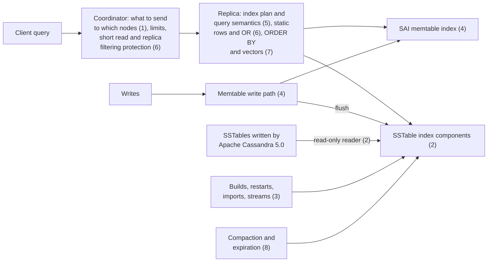
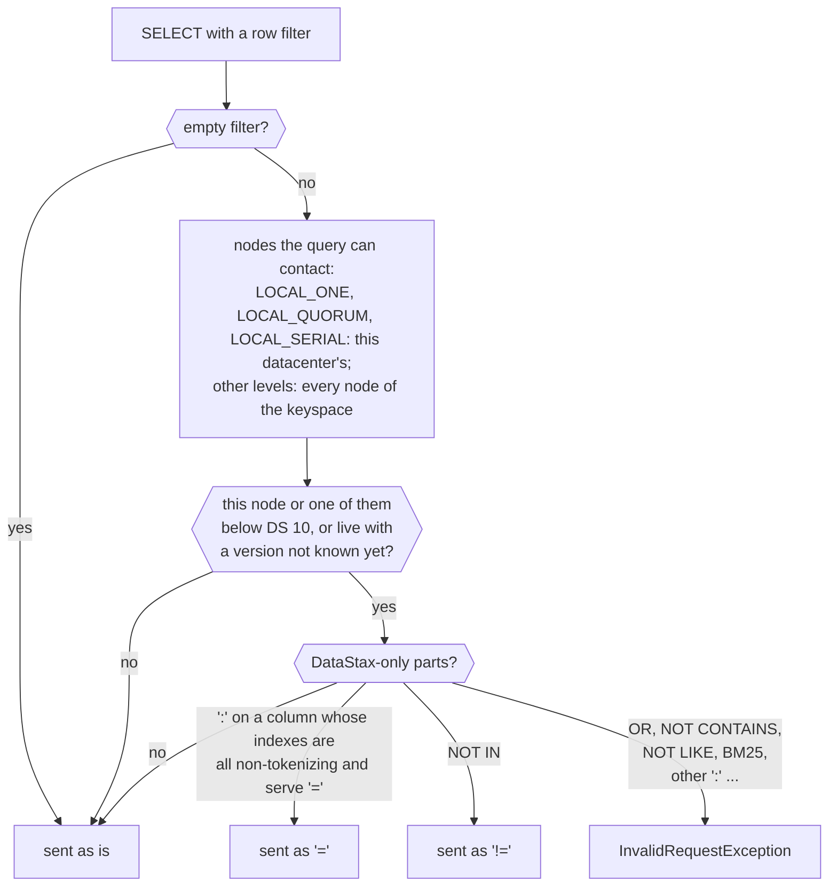
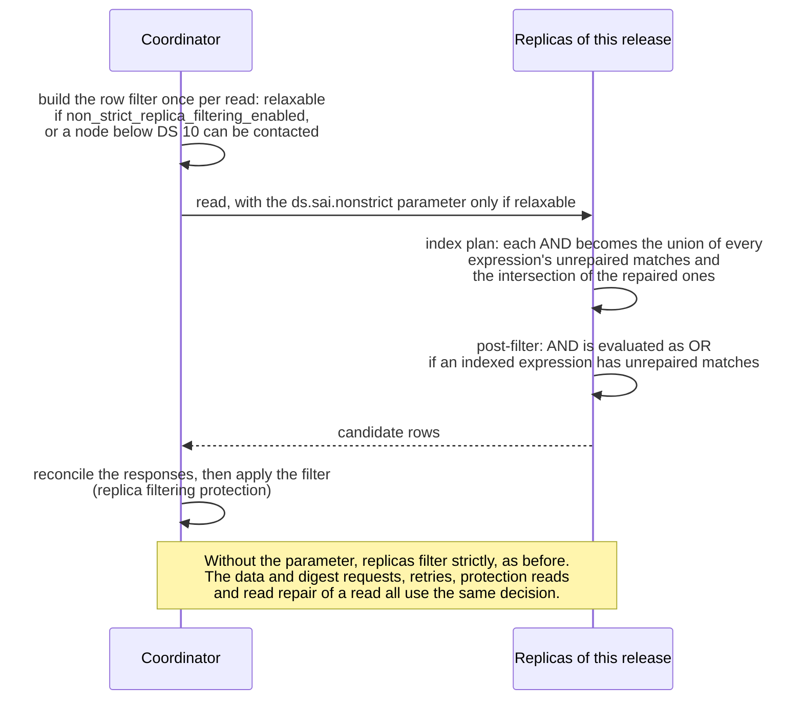
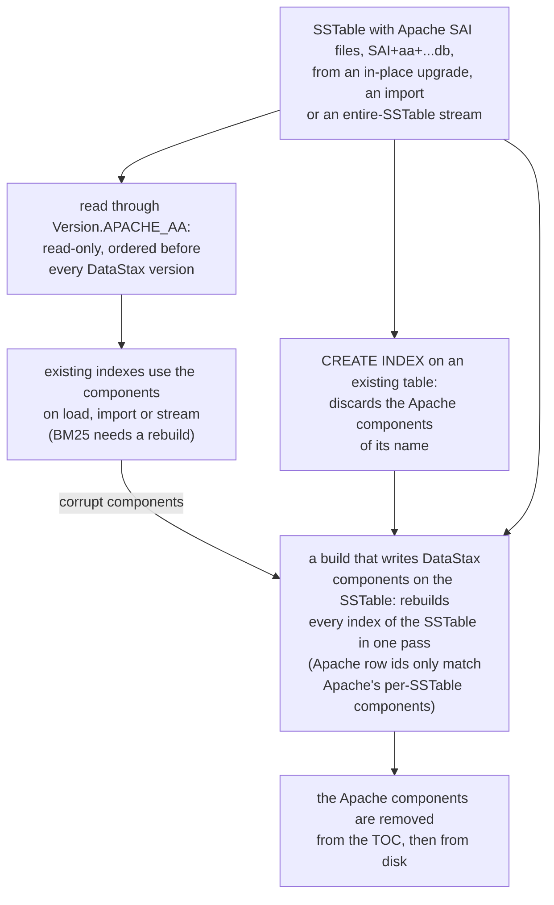
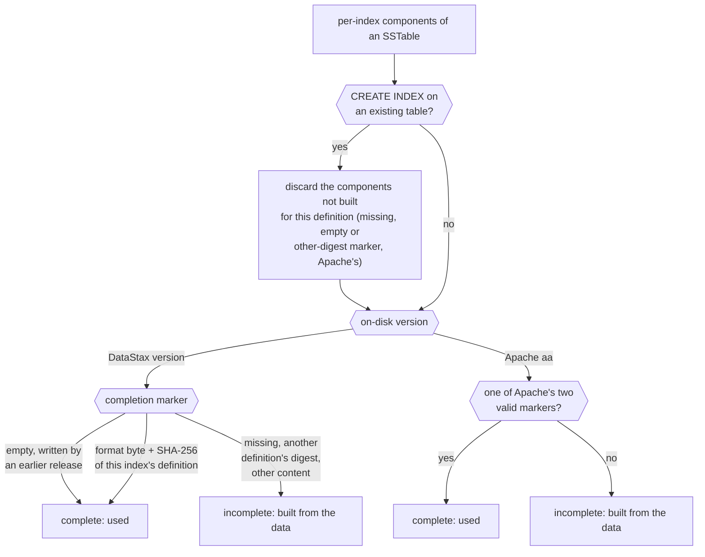
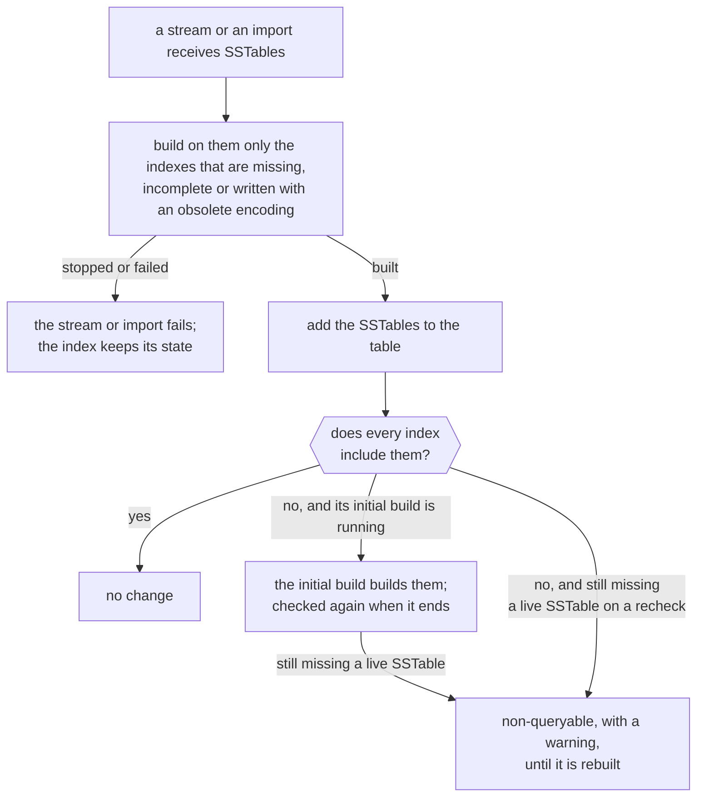
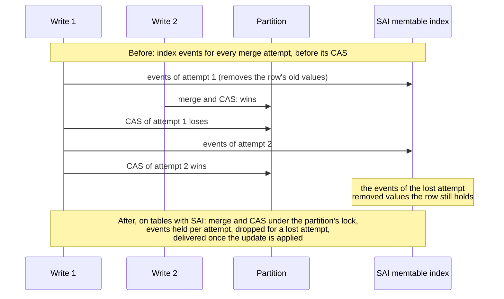

# Review guide: Apache SAI fixes restored on DataStax main-5.0

*Read it as a web page: <https://jeremiahdjordan.github.io/ai-review-guides/sai-apache-ports/>*

This guide is for reviewers, human or AI, of the commits that bring Apache Cassandra's Storage-Attached Index (SAI)
fixes into DataStax's Cassandra 5.0 line. The [overview](https://jeremiahdjordan.github.io/ai-review-guides/sai-apache-ports/overview.html) says on one page what main-5.0 was missing; the
[audit report](https://jeremiahdjordan.github.io/ai-review-guides/sai-apache-ports/audit-report.html) has the full classification of every Apache SAI commit, the test evidence and the
bugs filed.

## Summary

- **Branch:** `main-5.0-fb7f1b7aee-merge` (mainline in this guide): DataStax's 5.0 line (main-5.0, branch `main` of
  datastax/cassandra) merged with Apache `cassandra-5.0` at [`fb7f1b7aee`](https://github.com/JeremiahDJordan/cassandra/commit/fb7f1b7aeebb9565305aad76025530dc30f697fb), published as
  [`in-progress/main-5.0-fb7f1b7aee-merge`](https://github.com/JeremiahDJordan/cassandra/tree/in-progress/main-5.0-fb7f1b7aee-merge)
  on JeremiahDJordan/cassandra. The commit IDs below link to it. Its history has been rewritten before; if an ID
  doesn't resolve, find the commit by its subject.
- **Commits:** 106 commits, `git log --reverse fa5d580418e..ae493d880df`
  ([on GitHub](https://github.com/JeremiahDJordan/cassandra/compare/fa5d580418e...ae493d880df)), plus [`1d5c08a0ffb`](https://github.com/JeremiahDJordan/cassandra/commit/1d5c08a0ffbf5d0e821e6609420a6bdade3c23e6) (return only the selected
  static columns from a trie memtable partition read with no slice), which landed earlier. Every commit has a
  `CNDB-XXX: 
` subject and Jeremiah Jordan as author, except the CNDB-19682 cherry-pick ([`572931a4f9b`](https://github.com/JeremiahDJordan/cassandra/commit/572931a4f9b32e21f8217beeec8c6b3ff8ab4ab9)),
  which keeps its subject and original author.
- **Size:** about 64,000 added lines, three quarters of them tests. The biggest commits are the reader of Apache-written
  SAI files ([`5e60c1c499a`](https://github.com/JeremiahDJordan/cassandra/commit/5e60c1c499afecd8de0fbd3eddb16f72e7b7891f), +8,941), non-strict replica filtering ([`017d9e35c59`](https://github.com/JeremiahDJordan/cassandra/commit/017d9e35c5935b7096e6dfca6819a2ba3887a546), +5,834) and the static-row and row
  numbering fix ([`925eff0c75d`](https://github.com/JeremiahDJordan/cassandra/commit/925eff0c75dfabdbbbdd39f1c0f61b5d2f42f4f7), +4,124).
- **State:** the full unit and in-JVM dtest suites pass on the published branch tip (see [Evidence](#evidence)).

## Scope

1. The audit checked all 220 Apache `cassandra-5.0` and `trunk` SAI commits against DataStax main-5.0 by behaviour:
   34 are restored by these commits, 120 were already present or equivalent, 57 don't apply, 4 are kept as
   documented deviations and 5 are deferred.
2. Many commits fix DataStax-only bugs in the same code. The restored fixes and their tests depend on them.

## Commit review

- **Commit message.** Each message specifies what was wrong, why, and what changed, with a reproducer
  in plain CQL where there is one. Check the code against the message, then the message against the code: a
  behaviour the code changes that the message doesn't mention is a finding.
- **Provenance lines** at the end of a message name the upstream source:
  `Adapted from CASSANDRA-NNNNN (apache/cassandra commit <sha>).` for ported code,
  `Tests adopted from CASSANDRA-NNNNN (...)` for ported tests, and `(cherry picked from commit <sha>)` for an
  unchanged pick. Compare an adapted commit with its Apache commit: the differences should be what this SAI's code
  needs, not a different fix.
- **One complete fix per commit.** A commit doesn't need a later commit to be correct. A later commit that changes an
  earlier one's code says so in its message.
- **NEWS.txt** gets an entry for every change an operator can see: new settings, changed results, upgrade steps.
  Check that the entry exists and that it matches the code.

Check in every commit:

1. **Tests fail without the fix.** For a behaviour change, revert the production change and run the commit's new
   tests: at least one must fail; the others may cover behaviour the fix keeps. SAI tests write version `ec` unless
   told otherwise; for a change that depends on the on-disk version, also run them with the system property
   `cassandra.sai.latest.version=ga` (with ant: `-Dtest.jvm.args=-Dcassandra.sai.latest.version=ga`), or the version
   the message names.
2. **Tests match their neighbours.** New tests use the same base class and helpers as the tests next to them
   (`SAITester`/`CQLTester`, `createTable`, `execute`, `assertRows`, `flush`, `compact`), and in-JVM dtests use
   `cluster.coordinator(n).execute`.
3. **Comments are short and state facts.** No comments that narrate the change or the bug's history.
4. **No new cost on the read and write hot paths** without a reason the message gives.
5. **Edge cases off the intended use** are refused with a clear error or documented, not handled with extra
   mechanisms.

## Priority commits

Review the commits with compatibility or concurrency impact first. A bug in these is hard to undo once released:

| Commit | Impact | Checks |
|---|---|---|
| [`59001b61e92`](https://github.com/JeremiahDJordan/cassandra/commit/59001b61e92050ec884b5ecadf05ea2e13f0f330) Reject DataStax-only row filter features in queries that can reach Apache Cassandra nodes | Decides which queries are refused in a mixed cluster | Which nodes a query "can reach" per consistency level; the cache of the peer check and every event that invalidates it; that `:` is sent as `=` only where that is the same query |
| [`331dd77ba02`](https://github.com/JeremiahDJordan/cassandra/commit/331dd77ba029ff8154ca46fdf102e48dee2fb685) Support LIKE restrictions in filtering queries | Introduces messaging version DS 21 (111), announced but not used for serialization | Every place that compares versions: schema pull and push, `PrepareMessage`, `Batch`, serialized-size caches. Downgrade: is anything written in DS 21? |
| [`744cd7cf376`](https://github.com/JeremiahDJordan/cassandra/commit/744cd7cf3767d0fce48c014b317984b7688456b1) Support blob columns in SAI indexes | `CREATE INDEX` gated on every peer's version | Unknown and down peers count; the `new_feature_peer_version_check: none` opt-out |
| [`017d9e35c59`](https://github.com/JeremiahDJordan/cassandra/commit/017d9e35c5935b7096e6dfca6819a2ba3887a546) Relax SAI intersections on replicas when the coordinator enables non-strict filtering | Changes what replicas return and what the coordinator reconciles | The decision is made once per read and kept by every copy of the filter (digest, speculative retry, short-read and replica-filtering protection, read repair); the `ds.sai.nonstrict` message parameter |
| [`5e60c1c499a`](https://github.com/JeremiahDJordan/cassandra/commit/5e60c1c499afecd8de0fbd3eddb16f72e7b7891f) Read the SAI indexes written by Apache Cassandra 5.0 | New read-only on-disk version `aa(apache)` | Byte order, CRC32C checksums, key encoding, the block-balanced tree reader, jvector graph compatibility; that nothing ever writes this version; the `cassandra.sai.read_apache_format=false` switch |
| [`995d2963296`](https://github.com/JeremiahDJordan/cassandra/commit/995d2963296bcb2c098a5632090d4282ef0080bf) Don't let a new SAI index adopt stale components of a same-name index | Changes the completion marker's content | Legacy empty markers stay valid; the bounded marker read; older binaries only check existence |
| [`925eff0c75d`](https://github.com/JeremiahDJordan/cassandra/commit/925eff0c75dfabdbbbdd39f1c0f61b5d2f42f4f7) Index static rows on partition key components, and number SAI rows alike in every build | Changes row numbering in builds | Components written by earlier releases keep working; a mismatch in row counts fails the build rather than misreading |
| [`0235c5d3984`](https://github.com/JeremiahDJordan/cassandra/commit/0235c5d398482723b2fc97271205ce0b97a9f7c7) Apply SAI updates to skip-list memtables atomically, so racing writes keep index entries | Serializes writes per partition on tables with SAI | Lock scope; which indexers request atomic updates; bookkeeping of an applied update when the index transaction fails |
| [`ca4909363c8`](https://github.com/JeremiahDJordan/cassandra/commit/ca4909363c80c5f1ce78328d8cd107ba7ce94666) Accept partition keys that share a token in SAI version GA, and look them up by key | Primary key map lookups on every version | Exact, ceiling and floor lookups for keys sharing a token, per map type and version |
| [`998ea989cb5`](https://github.com/JeremiahDJordan/cassandra/commit/998ea989cb55bc629f936943c6786fb704f00f77) Index map entries, frozen values and varints in canonical form in SAI | New term encoding for some values | Old indexes are still searched with values as written; size checks use the canonical size |
| [`817347ca894`](https://github.com/JeremiahDJordan/cassandra/commit/817347ca894d56d8dc9f8608e76a93047dd4359b) Fail a read that only an unknown index can serve as an index not available | Read path on replicas that don't know an index yet | Equality falls back to filtering; a full-primary-key `:` read uses the analyzer if it has one; other reads that need an unavailable index, and reads whose index hint includes one, fail with "index not available", never an internal error |

## Decisions

A review should check that the code and the documentation agree with these, not reopen them:

- **Replica filtering stays strict by default.** CASSANDRA-19018's relaxed filtering is restored behind
  `sai_options.non_strict_replica_filtering_enabled` (default `false`), because it can make queries much more
  expensive.
- **CASSANDRA-18490's checksum check on partial builds is on by default**, as in Apache Cassandra.
- **A null element of a filtered single-column `IN` is ignored**, as in Apache Cassandra 5.0. An earlier mainline
  commit rejected it.
- **`CONTAINS`, `CONTAINS KEY` and their negations on an unindexed frozen collection** are evaluated per element
  during SAI post-filtering; CASSANDRA-21863 rejects that case.
- **Documented deviations:** CASSANDRA-18730 (the vector dimension guardrail default), CASSANDRA-20334
  (`prioritize_over_legacy_index` defaults to `true`), CASSANDRA-18782 (`case_sensitive`, `normalize` and `ascii` are
  accepted on primary key columns, have no effect there, and warn for non-default values) and CASSANDRA-21515 (a
  full rebuild of one index rewrites the shared per-SSTable components).
- **Deferred to a 6.0-based line:** `BETWEEN` (CASSANDRA-19604, 19688, 19878, 20154) and CASSANDRA-18492.
- **Read-only Apache `aa` format:** these commits read Apache's `aa` format through a read-only version; nothing in them writes
  it.

## Commits by area

The [commit list](#commit-list) gives all 107 commits in branch order with their sources and tests. The
same commits by area, with the area numbers showing where each area acts:

### 1. Mixed clusters with Apache Cassandra 5.0 nodes

[`59001b61e92`](https://github.com/JeremiahDJordan/cassandra/commit/59001b61e92050ec884b5ecadf05ea2e13f0f330), [`331dd77ba02`](https://github.com/JeremiahDJordan/cassandra/commit/331dd77ba029ff8154ca46fdf102e48dee2fb685), [`744cd7cf376`](https://github.com/JeremiahDJordan/cassandra/commit/744cd7cf3767d0fce48c014b317984b7688456b1), [`017d9e35c59`](https://github.com/JeremiahDJordan/cassandra/commit/017d9e35c5935b7096e6dfca6819a2ba3887a546) (with [`c527cfcaffb`](https://github.com/JeremiahDJordan/cassandra/commit/c527cfcaffbc3a6ac730131e35a02064ba795290), CASSANDRA-20189, below), [`a23830ebd5d`](https://github.com/JeremiahDJordan/cassandra/commit/a23830ebd5dea54b32aee85489818b556a8d5b76)
(CASSANDRA-21700), [`817347ca894`](https://github.com/JeremiahDJordan/cassandra/commit/817347ca894d56d8dc9f8608e76a93047dd4359b).

A DataStax 5.0 cluster can contain Apache Cassandra 5.0 nodes during a migration. Apache Cassandra 5.0 nodes are on
messaging version 13; DataStax nodes are on DS 10 (100) or later. These commits decide what a
DataStax node sends to them and what it refuses.

A query whose filter has parts that only DataStax nodes can read ([`59001b61e92`](https://github.com/JeremiahDJordan/cassandra/commit/59001b61e92050ec884b5ecadf05ea2e13f0f330)):

The result of the node check is cached per keyspace and scope until a messaging version, gossip state, liveness,
peer, token metadata or keyspace replication changes. A node not counted yet is still protected: the serializers
refuse these parts for a node below DS 10, and the request fails at once. LIKE has its own check, at DS 21
([`331dd77ba02`](https://github.com/JeremiahDJordan/cassandra/commit/331dd77ba029ff8154ca46fdf102e48dee2fb685)).

[`c527cfcaffb`](https://github.com/JeremiahDJordan/cassandra/commit/c527cfcaffbc3a6ac730131e35a02064ba795290) also relaxes the post-filter of unindexed columns when the index matches are repaired. Non-strict
replica filtering ([`017d9e35c59`](https://github.com/JeremiahDJordan/cassandra/commit/017d9e35c5935b7096e6dfca6819a2ba3887a546)), for a row whose indexed columns were written to different replicas:

Ordered queries, ONE and LOCAL_ONE, single-replica keyspaces and filters on one mutable column stay strict. A filter made
strict can't be sent to a node below DS 10, which would relax it: the serializer refuses it, and when that fails a
`SELECT`, the coordinator reads the query or page once more with a filter that replicas can relax.

Check:
- Decisions about what to send use the **messaging version** only, never a release version. A peer below DS 10 is an
  Apache Cassandra node (or a DataStax node pinned to Apache's version).
- Node and peer metadata comes from `org.apache.cassandra.nodes`, which DataStax deployments can replace with their
  own implementation.
- A refused query gets an `InvalidRequestException` that says why, not a wrong result from the Apache node.
- The read after a refused strict filter happens once, with new selectors, and doesn't repeat warnings.
- Tests: the in-JVM dtests of these commits (`DataStaxOnlyRowFilterDistributedTest`, `LikeAcrossDatacentersTest`,
  `BlobIndexDistributedTest`) cover peers on older messaging versions.

### 2. On-disk formats

This SAI's on-disk versions are, oldest first, AA (DSE 6.8), BA, CA, DB, DC, EB, EC (written by default), ED, FA, FB
and GA. Apache Cassandra 5.0's `aa` is a different format, read here as `aa(apache)`.

[`5e60c1c499a`](https://github.com/JeremiahDJordan/cassandra/commit/5e60c1c499afecd8de0fbd3eddb16f72e7b7891f) (Apache reader), [`72911dd398b`](https://github.com/JeremiahDJordan/cassandra/commit/72911dd398b180c4abc53291a4ffa2b82e0bc716) (vector checksums, CASSANDRA-21516), [`ca4909363c8`](https://github.com/JeremiahDJordan/cassandra/commit/ca4909363c80c5f1ce78328d8cd107ba7ce94666) (token collisions at
GA), [`998ea989cb5`](https://github.com/JeremiahDJordan/cassandra/commit/998ea989cb55bc629f936943c6786fb704f00f77) (canonical terms), [`5d22616e371`](https://github.com/JeremiahDJordan/cassandra/commit/5d22616e371db107087034833c341473452591ab) (DESC inet, varint and decimal clustering columns,
CASSANDRA-20100),
[`820800c8532`](https://github.com/JeremiahDJordan/cassandra/commit/820800c8532dbe414b2d89c5cd0ae3a5e8e3efa5) and [`ac2d89aeea3`](https://github.com/JeremiahDJordan/cassandra/commit/ac2d89aeea30df9228b88bf721b03ac97d139508) (behaviour before versions DC and DB), [`95a19f32a62`](https://github.com/JeremiahDJordan/cassandra/commit/95a19f32a62fae18e10f648be6d8969046ecc26a) (rewrite corrupt per-SSTable
components, CASSANDRA-18490).

Check:
- No commit changes what an existing on-disk version writes, except where the message says so and gives the
  compatibility rule. A new behaviour that depends on the format is gated on the SAI version.
- Readers of older versions stay correct: the tests include SSTables written by earlier releases and by Apache
  Cassandra 5.0 (`test/data/...`), loaded and queried.
- [`95a19f32a62`](https://github.com/JeremiahDJordan/cassandra/commit/95a19f32a62fae18e10f648be6d8969046ecc26a) is on by default (`cassandra.sai.validate_per_sstable_checksum_on_partial_build`), as in Apache
  Cassandra; it adds reads to partial builds.

How SSTables with Apache Cassandra's SAI files are used ([`5e60c1c499a`](https://github.com/JeremiahDJordan/cassandra/commit/5e60c1c499afecd8de0fbd3eddb16f72e7b7891f)):

### 3. Index lifecycle: builds, restarts, imports and streams

[`60cfffb636a`](https://github.com/JeremiahDJordan/cassandra/commit/60cfffb636a878a76e7f12087275f40b49166d66), [`039862defa6`](https://github.com/JeremiahDJordan/cassandra/commit/039862defa6e2226219702825cb6fdd250237adf) (CASSANDRA-20732), [`904759d3a01`](https://github.com/JeremiahDJordan/cassandra/commit/904759d3a01b1fd659897741a10d757b1fc08113), [`995d2963296`](https://github.com/JeremiahDJordan/cassandra/commit/995d2963296bcb2c098a5632090d4282ef0080bf), [`c8e58e04874`](https://github.com/JeremiahDJordan/cassandra/commit/c8e58e0487474b5616fde9136b4875e3e8243f5b), [`7ca866b71d4`](https://github.com/JeremiahDJordan/cassandra/commit/7ca866b71d49c0ebf4c2f37a28c1e06721cfe657),
[`af4e52a0c11`](https://github.com/JeremiahDJordan/cassandra/commit/af4e52a0c119fbecc91d715185c8263b2b98e89a), [`2cb2f35aefb`](https://github.com/JeremiahDJordan/cassandra/commit/2cb2f35aefbbdd962cf8b6da5d5796b25ee4ff1b), [`e8a4b150529`](https://github.com/JeremiahDJordan/cassandra/commit/e8a4b1505292b3fe71021d98bc202040c4448335), [`1ae87c2c71a`](https://github.com/JeremiahDJordan/cassandra/commit/1ae87c2c71a86dc6ef910cc257c239b91d4d1be6), [`041930d6280`](https://github.com/JeremiahDJordan/cassandra/commit/041930d6280fc8516c6af3c814e88743bd82b040), [`ececdb3a126`](https://github.com/JeremiahDJordan/cassandra/commit/ececdb3a1268b70690d203b2e150865f57e8f445), [`4f5df98f6e3`](https://github.com/JeremiahDJordan/cassandra/commit/4f5df98f6e31f2c7369e329e96a34119f94af223),
[`1ea565c5b31`](https://github.com/JeremiahDJordan/cassandra/commit/1ea565c5b319a9e9258a58dc20e56321c9b71b00) (CASSANDRA-21671), [`ae493d880df`](https://github.com/JeremiahDJordan/cassandra/commit/ae493d880df3abb679ec52f7602bcaa24e9e7c44), [`5ac6f62ee4f`](https://github.com/JeremiahDJordan/cassandra/commit/5ac6f62ee4f2545c90f0562e273467da07991288) (CASSANDRA-19987), [`ac17666cdb8`](https://github.com/JeremiahDJordan/cassandra/commit/ac17666cdb8db97c1454de7a47132c555793eb0b) (writer abort
logging, CASSANDRA-20695).

These decide when an index is queryable. They check that an index covers the live SSTables it serves; the
truncation check came after the series, in [`f26bddc2a8f`](https://github.com/JeremiahDJordan/cassandra/commit/f26bddc2a8f9765c2216abc08b1155fe428742c9), and the [audit report](https://jeremiahdjordan.github.io/ai-review-guides/sai-apache-ports/audit-report.html#residuals) lists
the windows that remain.

When the per-index components of an SSTable count as complete ([`995d2963296`](https://github.com/JeremiahDJordan/cassandra/commit/995d2963296bcb2c098a5632090d4282ef0080bf), [`5e60c1c499a`](https://github.com/JeremiahDJordan/cassandra/commit/5e60c1c499afecd8de0fbd3eddb16f72e7b7891f), changed by
[`925eff0c75d`](https://github.com/JeremiahDJordan/cassandra/commit/925eff0c75dfabdbbbdd39f1c0f61b5d2f42f4f7)):

SSTables added directly by a stream or an import ([`c8e58e04874`](https://github.com/JeremiahDJordan/cassandra/commit/c8e58e0487474b5616fde9136b4875e3e8243f5b)):

Check:
- Every path that makes an index queryable or non-queryable (initial build, rebuild, restart, import, stream) checks
  the live SSTables, not a snapshot taken before the build; check which live SSTables each check includes, and when.
- A failed or stopped build leaves the index non-queryable, or fails only the stream or import, as the message says.
- Ownership and locks: who may write or delete an SSTable's component files while another build runs, and that a
  dropped index's build can't change the state of a new index of the same name.
- Races are tested by pausing threads at chosen calls with `inject.Injections` (Byteman). Check that each test
  asserts that its pause was reached: a pause on a call that no longer happens passes without testing anything.

### 4. Memtables and the write path

Trie memtables: [`1d5c08a0ffb`](https://github.com/JeremiahDJordan/cassandra/commit/1d5c08a0ffbf5d0e821e6609420a6bdade3c23e6), [`6aea1e383fa`](https://github.com/JeremiahDJordan/cassandra/commit/6aea1e383fa4a92e979594e5fcb6a0dcf06c3bab), [`fcb65f1ab87`](https://github.com/JeremiahDJordan/cassandra/commit/fcb65f1ab87c93ab0f4f1f1c788a5ffd31baa63f), [`572931a4f9b`](https://github.com/JeremiahDJordan/cassandra/commit/572931a4f9b32e21f8217beeec8c6b3ff8ab4ab9) and [`a6b52517ff5`](https://github.com/JeremiahDJordan/cassandra/commit/a6b52517ff56d4ff48c90c162528538d502a3354) (CNDB-19682),
[`ce4eebbd4f1`](https://github.com/JeremiahDJordan/cassandra/commit/ce4eebbd4f15a594cf9af35ddcaec14b27497c25), [`d4a5fc7aa74`](https://github.com/JeremiahDJordan/cassandra/commit/d4a5fc7aa74b3605c8a6917dea2d14db2b037512) (CNDB-19681), [`ecd92655eec`](https://github.com/JeremiahDJordan/cassandra/commit/ecd92655eec6b921b5a29ff8fee3824fa806c1f7).
SAI memtable index: [`ede0074ea84`](https://github.com/JeremiahDJordan/cassandra/commit/ede0074ea84ce12a3a245eb6136d6a169b866a28), [`3db4c8633e2`](https://github.com/JeremiahDJordan/cassandra/commit/3db4c8633e247f049d852fee787eebbbd82ee259), [`e630511ed8c`](https://github.com/JeremiahDJordan/cassandra/commit/e630511ed8c2e173188283f2f734e9f4a50aaabc), [`fbc982440ee`](https://github.com/JeremiahDJordan/cassandra/commit/fbc982440ee46705ca0c08c480b7d6ef12de408e), [`325279bbb41`](https://github.com/JeremiahDJordan/cassandra/commit/325279bbb41a3b8ea02a0fe287f64d7b9404a01e), [`5748d3e7455`](https://github.com/JeremiahDJordan/cassandra/commit/5748d3e7455c63beb01c19b17db36cc7cff62d32),
[`c5a989ceee0`](https://github.com/JeremiahDJordan/cassandra/commit/c5a989ceee0b868fc817235b20c479bae9ab1779), [`f6ac88c6c17`](https://github.com/JeremiahDJordan/cassandra/commit/f6ac88c6c17f689069a4369eb8e59cddffdf8d5a), [`967387eafc2`](https://github.com/JeremiahDJordan/cassandra/commit/967387eafc240c37f8e8ada42d495c497604394a), [`15d5fbcac7e`](https://github.com/JeremiahDJordan/cassandra/commit/15d5fbcac7ed2920de868fd5e3725416d1fe71b8).
Skip-list memtables and size limits: [`0235c5d3984`](https://github.com/JeremiahDJordan/cassandra/commit/0235c5d398482723b2fc97271205ce0b97a9f7c7), [`2c5484805c2`](https://github.com/JeremiahDJordan/cassandra/commit/2c5484805c2206b373744ef83a6a6127166d2d8b), [`37497e30e07`](https://github.com/JeremiahDJordan/cassandra/commit/37497e30e07e3d66af75bc2ae8611fbffa9d1e3a).
Indexers: [`86616f7bf63`](https://github.com/JeremiahDJordan/cassandra/commit/86616f7bf63a1c09ef43566831649c3da620a44d) (CASSANDRA-19675).

Two writes racing on one partition of a skip-list memtable ([`0235c5d3984`](https://github.com/JeremiahDJordan/cassandra/commit/0235c5d398482723b2fc97271205ce0b97a9f7c7)):

Check:
- An index event is delivered once per applied update, in apply order, and never for an update that wasn't applied.
- An update that keeps a value in a row doesn't remove that value from the index; a deletion or expiry removes
  only what it shadows.
- [`0235c5d3984`](https://github.com/JeremiahDJordan/cassandra/commit/0235c5d398482723b2fc97271205ce0b97a9f7c7) takes a partition lock only for tables whose indexers ask for atomic updates; NEWS.txt gives the
  throughput cost with many writers on one partition.

### 5. Query semantics

Restored from Apache: [`8faae9aa793`](https://github.com/JeremiahDJordan/cassandra/commit/8faae9aa793178fd68f6ca4ca523efcffab9427f) (equivalent of CASSANDRA-19177), [`190070cc374`](https://github.com/JeremiahDJordan/cassandra/commit/190070cc37453b06bcfd595256cc7f046f98eeec) (20191), [`91dd80addba`](https://github.com/JeremiahDJordan/cassandra/commit/91dd80addba454a1d636d6a3bc5a7f2cf36a36bd) (20243),
[`e1406d1499a`](https://github.com/JeremiahDJordan/cassandra/commit/e1406d1499a24cd2e9e8ea3399563765746e3be7) (20866), [`b6c0e11a1ab`](https://github.com/JeremiahDJordan/cassandra/commit/b6c0e11a1abd20f5da5317e8f0f333a6ccc171a8) (term size guardrails, 19493 and 18926), [`a11b47ad8ac`](https://github.com/JeremiahDJordan/cassandra/commit/a11b47ad8accb96fd0795ad2a1937cd03fd6b222) (19544), [`c0a1d0cba68`](https://github.com/JeremiahDJordan/cassandra/commit/c0a1d0cba685b919b4d71691567c3e4ff2b10743)
(19953), [`42e6e2ec137`](https://github.com/JeremiahDJordan/cassandra/commit/42e6e2ec1374b9913b793536c57e6aa05064e66e) (21525), [`13731e74fd5`](https://github.com/JeremiahDJordan/cassandra/commit/13731e74fd50dd900a1fbab92300fe4749c5ec18) (non-float vectors, 18715), [`f723d246377`](https://github.com/JeremiahDJordan/cassandra/commit/f723d2463771b3f424c876eb4bcbe55f077485c1) (equivalent of 20258).
Same case as an Apache ticket, handled differently: [`8d9619fa249`](https://github.com/JeremiahDJordan/cassandra/commit/8d9619fa2490c9c7e2c9d84b5f636dfacb2cba16) (CASSANDRA-21863 rejects the query; this
evaluates it per element), [`214dc9b9b8d`](https://github.com/JeremiahDJordan/cassandra/commit/214dc9b9b8dea19505a0e13b45f9631abc0cdb5b) (empty bounds; CASSANDRA-20313's problem, fixed another way).
DataStax-only fixes: [`cd3ce5321b2`](https://github.com/JeremiahDJordan/cassandra/commit/cd3ce5321b2d0a2f19d42e87996df16e1d28852d), [`fd61c6873d4`](https://github.com/JeremiahDJordan/cassandra/commit/fd61c6873d4282f752235cd7aa9e55cd68034379), [`e70ba28bab2`](https://github.com/JeremiahDJordan/cassandra/commit/e70ba28bab260095b825691c2efed88be9b05392), [`d7b5dd2f369`](https://github.com/JeremiahDJordan/cassandra/commit/d7b5dd2f36977c867fbb9a8614af9cb36ec70082), [`f6d46514c01`](https://github.com/JeremiahDJordan/cassandra/commit/f6d46514c0108e81de49e3da63c83672cd33bf8d),
[`5c4ac0ce4c9`](https://github.com/JeremiahDJordan/cassandra/commit/5c4ac0ce4c9d08879c2be9d3379d9b8570c94967), [`11abb672196`](https://github.com/JeremiahDJordan/cassandra/commit/11abb67219640e5a649b087e4ed019efa04f672d), [`8defe3bc673`](https://github.com/JeremiahDJordan/cassandra/commit/8defe3bc67337977aa7b0428d6df74124f19f68f), [`4a72521b752`](https://github.com/JeremiahDJordan/cassandra/commit/4a72521b752dfd884b3b8330e488a881e739cd7d), [`27de9b32cb3`](https://github.com/JeremiahDJordan/cassandra/commit/27de9b32cb33b0bf79db30c2405cba7cd3fb583d), [`a5bb64889ef`](https://github.com/JeremiahDJordan/cassandra/commit/a5bb64889efbbea4f3ca99705592b14dbab6b6e8), [`2f1db37a433`](https://github.com/JeremiahDJordan/cassandra/commit/2f1db37a433cd98f81affa11344bedcaaa720d4e),
[`e62738daee6`](https://github.com/JeremiahDJordan/cassandra/commit/e62738daee62928ddace6dbedc869bf5010c8df1).

Check:
- An SAI query returns the same rows as `ALLOW FILTERING` without the index, where both use the same matching and
  the index covers the same values (an analyzed index changes what `=` matches; empty values of non-literal types
  aren't indexed). Tests compare from the memtable, from SSTables and after compaction.
- Analyzed columns: `:`, `=`, `CONTAINS` and their negations each say which analyzer applies.
- Negations (`!=`, `NOT IN`, `NOT CONTAINS`, `NOT CONTAINS KEY`) never subtract index matches that weren't checked
  against the row.

### 6. Static rows, OR, paging and replica filtering protection

[`925eff0c75d`](https://github.com/JeremiahDJordan/cassandra/commit/925eff0c75dfabdbbbdd39f1c0f61b5d2f42f4f7), [`3c5bbbcc208`](https://github.com/JeremiahDJordan/cassandra/commit/3c5bbbcc20833c99748fa47ad38b94b86bc0954f), [`a8c4b2529ec`](https://github.com/JeremiahDJordan/cassandra/commit/a8c4b2529ec9085b9d5e0f0e9a2df419af31f491), [`8af41195ad5`](https://github.com/JeremiahDJordan/cassandra/commit/8af41195ad53eeb2a7ed618d5aa466a62afd8f7f), [`3f9e28fc617`](https://github.com/JeremiahDJordan/cassandra/commit/3f9e28fc617a99416e041126ce37217575130251), [`914fcd63296`](https://github.com/JeremiahDJordan/cassandra/commit/914fcd6329608d8a217fe7695db8fe4f6df44b1e), [`d2fbec59d50`](https://github.com/JeremiahDJordan/cassandra/commit/d2fbec59d50ed38fb424cf98da9a341aaee38e86),
[`6d42b5aea4c`](https://github.com/JeremiahDJordan/cassandra/commit/6d42b5aea4c1bafda4120d041bd05a35c6265864), [`406eb1cceaf`](https://github.com/JeremiahDJordan/cassandra/commit/406eb1cceafeba6bf1702aed69c87ee2ea011657), [`bef8706e945`](https://github.com/JeremiahDJordan/cassandra/commit/bef8706e945ac429680af6f6b9132d04c98ff502), [`d00fa3410ea`](https://github.com/JeremiahDJordan/cassandra/commit/d00fa3410eaa1c1a9d17b85e7b5eb12648f9462f).

Partitions that have only a static row, and filters that mix static and regular columns, are where SAI, `RowFilter`,
limits and the coordinator's reconciliation disagreed.

Check:
- A replica returns a partition for its static row alone only when that row satisfies the filter on its own.
- Limits, `PER PARTITION LIMIT` and paging count those partitions.
- Replica filtering protection reads the whole partition from a replica whose static row is stricter than the
  merged one. Apache Cassandra 5.0 has the same gap; the message of [`d00fa3410ea`](https://github.com/JeremiahDJordan/cassandra/commit/d00fa3410eaa1c1a9d17b85e7b5eb12648f9462f) gives the case.
- What a replica holds while it waits to decide is bounded by the tombstone failure threshold.

### 7. ORDER BY and vector search

[`3e1c35ba143`](https://github.com/JeremiahDJordan/cassandra/commit/3e1c35ba1432c4e64a677af993bb90d15a02d837) (CASSANDRA-19661), [`3d5f5d1e18e`](https://github.com/JeremiahDJordan/cassandra/commit/3d5f5d1e18ee8a78ed5f099e4b1435d8d6cdac8b) (tests from 20086), [`40881baecc3`](https://github.com/JeremiahDJordan/cassandra/commit/40881baecc37962c406b0a403f420ab52a3220cb), [`d2e480e4ca2`](https://github.com/JeremiahDJordan/cassandra/commit/d2e480e4ca2a2fd115fa202d47416b0feaff7787), [`50deef58ddf`](https://github.com/JeremiahDJordan/cassandra/commit/50deef58ddfd61a4eb38ed6b277248e4abe13717),
[`d98b674b593`](https://github.com/JeremiahDJordan/cassandra/commit/d98b674b5936a2e5e872f99d635ae22f157457fd), [`6d56a449bca`](https://github.com/JeremiahDJordan/cassandra/commit/6d56a449bcad7a81cd681a6076454f97dc134b97), [`be474291df8`](https://github.com/JeremiahDJordan/cassandra/commit/be474291df80adc408a17a8277bd89121bd4df2a).

Check:
- Each partition and row is returned at most once, and the limit counts rows, not keys.
- With a vector in a primary key column, a dead row is never returned.
- Vector recall tests check recall over many queries, not one; a single graph search can miss a reachable row.

### 8. Compaction and expiration

[`67f7c0f321a`](https://github.com/JeremiahDJordan/cassandra/commit/67f7c0f321ae6f1eb9186af3f0a3b020397939dd) and [`e020bdb9709`](https://github.com/JeremiahDJordan/cassandra/commit/e020bdb9709227b536a4e466a53c2d38d0ad2b10) (CASSANDRA-20829, compaction and UCS expiration tasks), [`af4e52a0c11`](https://github.com/JeremiahDJordan/cassandra/commit/af4e52a0c119fbecc91d715185c8263b2b98e89a).

Check that dropping a fully expired SSTable still tells the indexes that ask for it about its rows, and that
compaction and expiration read such an SSTable only when an index asks; SAI doesn't.

### 9. Documentation, tests and the segments table name

[`139023540a7`](https://github.com/JeremiahDJordan/cassandra/commit/139023540a7146ad4923d6f1bd9fc39d8c97e50d) (Apache regression tests for fixes this SAI already had), [`712213c8618`](https://github.com/JeremiahDJordan/cassandra/commit/712213c8618f82c931c5e42919a4a2670dbc5dc7) (differences from Apache
Cassandra 5.0), [`b249e01ec29`](https://github.com/JeremiahDJordan/cassandra/commit/b249e01ec2928948c34cc7997db766260304ae51), [`72d4f619b3a`](https://github.com/JeremiahDJordan/cassandra/commit/72d4f619b3a5aa022d4ff34837fe0054047de44a), [`c0a17e8c373`](https://github.com/JeremiahDJordan/cassandra/commit/c0a17e8c373463dd30bdb174b7de0a2731b1a1c9), [`79838eeeace`](https://github.com/JeremiahDJordan/cassandra/commit/79838eeeace5fe3b7facabc7264d5214bbe608fe), and [`7315a1b014e`](https://github.com/JeremiahDJordan/cassandra/commit/7315a1b014e5560db71070b3e2f5c9fb93edc781), which registers the
SAI segments virtual table under the name tools written for Apache Cassandra expect.

Check that each documented difference matches the code.

## Later commits

These commits on mainline after the series, up to [`5458f446c35`](https://github.com/JeremiahDJordan/cassandra/commit/5458f446c35ac71f2dc0ad68dc69f8130661301f), change the index code, `RowFilter`, what is sent to
older nodes, a test this guide names, or the harness for testing with Apache Cassandra nodes. Read each with the
series commit it changes:

| Commit | Subject |
|---|---|
| [`420050d1ca9`](https://github.com/JeremiahDJordan/cassandra/commit/420050d1ca92dd8840166e6755d0ca84f7b63e5c) | Fix a NullPointerException in ANN ordering by a primary key vector with approximate scores |
| [`f26bddc2a8f`](https://github.com/JeremiahDJordan/cassandra/commit/f26bddc2a8f9765c2216abc08b1155fe428742c9) | Don't make an SAI index queryable on truncate when it misses a kept SSTable |
| [`383d01820d5`](https://github.com/JeremiahDJordan/cassandra/commit/383d01820d538bdddeaabc25240d3990e8a17839) | Combine the term ranges of SAI segments as each segment computes its own |
| [`8f3696dcb89`](https://github.com/JeremiahDJordan/cassandra/commit/8f3696dcb899930b039e8dc8f73836dca2820b13) | Compute SAI decimal range estimates with a bounded precision |
| [`d53d02c5a61`](https://github.com/JeremiahDJordan/cassandra/commit/d53d02c5a61a1705b07c6db26a6cca38917264ed) | Accept SAI analyzer configs without a tokenizer |
| [`4531842dd36`](https://github.com/JeremiahDJordan/cassandra/commit/4531842dd36820caca9598061e4662ad355a65cf) | Warn on SAI n-gram analyzers named "nGram" |
| [`22f21a98b24`](https://github.com/JeremiahDJordan/cassandra/commit/22f21a98b2460103490be523bfc773f512855c4c) | Finish an index build only once every builder of every building-support group is done |
| [`ba219866320`](https://github.com/JeremiahDJordan/cassandra/commit/ba219866320c6b55c251f61867c27be54386d9c0) | Keep the SSTables of a build listed for the indexes still building them |
| [`b7a7722a918`](https://github.com/JeremiahDJordan/cassandra/commit/b7a7722a918e26d96b0c529ee6a54b0538a2d054) | Filter LIKE suffix and contains literals without compiling an automaton unless an index searches them |
| [`59ebb026f4e`](https://github.com/JeremiahDJordan/cassandra/commit/59ebb026f4e7a625fd87a577f56ec04555df1f7c) | Send replica write warnings to the client |
| [`e2d9c3f10ec`](https://github.com/JeremiahDJordan/cassandra/commit/e2d9c3f10ec610a0b29c34f5c6becd6f28858951) | Warn when SAI doesn't index an oversized term |
| [`338b9eb42df`](https://github.com/JeremiahDJordan/cassandra/commit/338b9eb42df6bf74d24817393c01a973ae4555be) | Treat an SAI IN on an analyzed column as a disjunction of analyzed equalities |
| [`575b7e50c50`](https://github.com/JeremiahDJordan/cassandra/commit/575b7e50c504411798a73f67ce95cd30343c3b20) | Don't list unwritten SAI components in the TOC of streamed and rewritten SSTables |
| [`faac7bd1f1f`](https://github.com/JeremiahDJordan/cassandra/commit/faac7bd1f1f96db446ca35fe97746233abb7c820) | Write the sstable versions of Apache Cassandra outside of storage compatibility mode HCD_1 |
| [`9c592dec741`](https://github.com/JeremiahDJordan/cassandra/commit/9c592dec7412012e0bd34f0c5c491353d9c8aa6f) | Compare cell values across accessors when cleaning up legacy index entries |
| [`ad9b5bd7fe9`](https://github.com/JeremiahDJordan/cassandra/commit/ad9b5bd7fe9b4d6b801ca08b8e8d19be57526057) | Decode counters for != in row filters |
| [`50cfa53fc56`](https://github.com/JeremiahDJordan/cassandra/commit/50cfa53fc566d7966fde11ca648ea622210b1bf2) | Always gossip the SAI index status in the compact format |
| [`4109fa4ab63`](https://github.com/JeremiahDJordan/cassandra/commit/4109fa4ab63ea6f080655f8bb2cac74a706da6f6) | Don't send multi-range SAI reads to nodes below DS 10 |
| [`bb6055c8aff`](https://github.com/JeremiahDJordan/cassandra/commit/bb6055c8aff07cc5e9f62a29260203904c04b44b) | Don't send synthetic score columns to nodes below DS 10 |
| [`d8336fbe240`](https://github.com/JeremiahDJordan/cassandra/commit/d8336fbe240d640325f9e90a316a3c91a61c4066) | Send unknown column and table failures to Apache Cassandra nodes as INCOMPATIBLE_SCHEMA |
| [`331ca377e51`](https://github.com/JeremiahDJordan/cassandra/commit/331ca377e51b2d0ba1fba5c06cee1441d8602e1a) | Compare the excluded values of an SAI range on a literal column with the value |
| [`951daaa61aa`](https://github.com/JeremiahDJordan/cassandra/commit/951daaa61aab170bf63b899afa59f086521b3f7e) | Filter unindexed map entries that don't fit in an SAI entry term |
| [`b01b03f6c67`](https://github.com/JeremiahDJordan/cassandra/commit/b01b03f6c679019a546e67ee526b46826c128821) | Refuse SAI-filtered != and non-strict IN while Apache Cassandra 5.0 nodes can be contacted |
| [`72321e7e573`](https://github.com/JeremiahDJordan/cassandra/commit/72321e7e5734c0b261fb0a7f0b17d020c7aea752) | Refuse SAI-filtered CONTAINS on frozen collections while Apache Cassandra 5.0 nodes can be contacted |
| [`b6565d334eb`](https://github.com/JeremiahDJordan/cassandra/commit/b6565d334eb9c3dbf3b3a9bd841f93c401f60e0f) | Check single-row graph search apart from brute force in VectorKeyRestrictedOnPartitionTest |
| [`53d8b40666a`](https://github.com/JeremiahDJordan/cassandra/commit/53d8b40666a757c811800e71219b709ca6d003d8) | Count disconnected outbound connections at the node's known messaging version |
| [`c7e188450fa`](https://github.com/JeremiahDJordan/cassandra/commit/c7e188450faac378950ce141f225b5b4a1c45a89) | Compare != and NOT IN with the analyzer of = on a column whose SAI index serves = as a match |
| [`ce5b09f969a`](https://github.com/JeremiahDJordan/cassandra/commit/ce5b09f969a49aaf370db84b1e188bf5efdca21b) | Match no row with an SAI search of an analyzed value without terms |
| [`a5c101d830f`](https://github.com/JeremiahDJordan/cassandra/commit/a5c101d830f65c7a59d4f118af5023bc939625c4) | Check every analyzed SAI term against the term size guardrail |
| [`1552286f643`](https://github.com/JeremiahDJordan/cassandra/commit/1552286f6434b6ab688e61d1b9a5a8b1d012e0ea) | Widen SAI builds for a numbering change only in full rebuilds, over complete components |
| [`a5aa8d8b25e`](https://github.com/JeremiahDJordan/cassandra/commit/a5aa8d8b25e95c9cab8a85520fac399566ea9c3d) | Test RowFilter's partitions starting with a marker and the bound on deletions SAI holds |
| [`6f954252729`](https://github.com/JeremiahDJordan/cassandra/commit/6f954252729408b00424621750ea7265db94bac4) | Add an in-JVM dtest harness for clusters mixing nodes of this build with Apache Cassandra nodes |
| [`567be9c4212`](https://github.com/JeremiahDJordan/cassandra/commit/567be9c421233486f7f2a31b99518c30a24f5147) | Mark null components of OSS50 byte-comparable sequences as Apache Cassandra 5.0 does |
| [`6168b55d8d0`](https://github.com/JeremiahDJordan/cassandra/commit/6168b55d8d07b2671b5f7d47e227f6aa978877d1) | Compare applied schemas in `ApacheMixedClusterTestBase#schemaChange` |

## Evidence

- On earlier bases of the series: build and lint passed at commits 002 to 105 on [`4ee9a6be339`](https://github.com/JeremiahDJordan/cassandra/commit/4ee9a6be339fc77fac26494076b0543c24b85d47), and on
  [`969923965e8`](https://github.com/JeremiahDJordan/cassandra/commit/969923965e8de828c85df955e3ba9fba3b791567) the SAI test sweep passed at the default on-disk version (19,497 unit tests and 565 in-JVM dtests)
  and at version GA with the vector tests (21,139 unit tests and 575 in-JVM dtests).
- The full suites on the published tip [`5458f446c35`](https://github.com/JeremiahDJordan/cassandra/commit/5458f446c35ac71f2dc0ad68dc69f8130661301f) (the series and the later commits above): 40,906 unit tests (277
  skipped) and 2,615 in-JVM dtests (23 skipped) on JDK 11, 0 failures. Not run: Python dtests, JDK 17 and 21.
- 22 commits record a run of their new tests failing without the fix, or without the part of it named; the
  [audit report](https://jeremiahdjordan.github.io/ai-review-guides/sai-apache-ports/audit-report.html#series) gives each commit's test evidence.
- `VectorKeyRestrictedOnPartitionTest` was flaky with and without the series: a single graph search under a one-key
  filter can miss one row, which brute force finds. [`b6565d334eb`](https://github.com/JeremiahDJordan/cassandra/commit/b6565d334eb9c3dbf3b3a9bd841f93c401f60e0f) changes the test.

The [audit report](https://jeremiahdjordan.github.io/ai-review-guides/sai-apache-ports/audit-report.html) has the per-run numbers, every failure seen and its cause, and the issues filed
for bugs that aren't fixed here.

## AI reviewer instructions

Give the reviewer one commit, or one area above, at a time, with:

1. the commit (`git show <sha>`) and, for an adapted commit, the Apache commit from its provenance line;
2. the "Check" list of its area and the [checks for every commit](#commit-review);
3. the instruction to report each finding with a severity (blocker, should fix, nit), the file and line, a concrete
   failing case, and a suggested fix, and to say plainly when it found nothing.

Then triage: fix correctness, data loss and missing tests; decline style preferences and pre-existing issues outside
the commit with a one-line reason, and file those separately if they are real bugs.

## Commit list

In branch order; [`1d5c08a0ffb`](https://github.com/JeremiahDJordan/cassandra/commit/1d5c08a0ffbf5d0e821e6609420a6bdade3c23e6) landed before the range. `#` is the commit's number in the audit report's series
table. "Port of" with a commit link means the message carries an `Adapted from` line for that source; "Tests from"
means only the tests came from it. A source without a commit link is named in the message text only.

| # | Commit | Subject | Source | Size | Main tests |
|---|---|---|---|---|---|
| 001 | [`1d5c08a0ffb`](https://github.com/JeremiahDJordan/cassandra/commit/1d5c08a0ffbf5d0e821e6609420a6bdade3c23e6) | Return only the selected static columns from a trie memtable partition read with no slice | DataStax-only fix | +312 | `TrieMemtableStaticRowSelectionTest`, `StaticRowSelectionPagingTest` |
| 002 | [`6aea1e383fa`](https://github.com/JeremiahDJordan/cassandra/commit/6aea1e383fa4a92e979594e5fcb6a0dcf06c3bab) | Don't reset TrieMemtableStage3's partition counters on a partition deletion | DataStax-only fix | +139 | `PartitionDeletionFlushTest` |
| 003 | [`fcb65f1ab87`](https://github.com/JeremiahDJordan/cassandra/commit/fcb65f1ab87c93ab0f4f1f1c788a5ffd31baa63f) | Break ties between equal deletion times by kind in trie memtables | DataStax-only fix | +248 | `EqualTimestampTombstoneTest`, `TrieTombstoneMarkerTest` |
| 004 | [`f723d246377`](https://github.com/JeremiahDJordan/cassandra/commit/f723d2463771b3f424c876eb4bcbe55f077485c1) | Don't under-skip memtable keys of a partition without a static key | Equivalent of [CASSANDRA-20258](https://issues.apache.org/jira/browse/CASSANDRA-20258) for this SAI Tests from [CASSANDRA-20258](https://issues.apache.org/jira/browse/CASSANDRA-20258) ([a118a704cbe](https://github.com/apache/cassandra/commit/a118a704cbe31bc72699595f112dda7870c85287)) | +486 | `SortedSetKeyRangeIteratorTest`, `CompositePartitionKeyIndexStaticTest` |
| 005 | [`8faae9aa793`](https://github.com/JeremiahDJordan/cassandra/commit/8faae9aa793178fd68f6ca4ca523efcffab9427f) | Close SAI iterators that a timed-out query opened but didn't hand over | Equivalent of [CASSANDRA-19177](https://issues.apache.org/jira/browse/CASSANDRA-19177) for this SAI | +227 | `AbortedQueryResourceCleanupTest` |
| 006 | [`190070cc374`](https://github.com/JeremiahDJordan/cassandra/commit/190070cc37453b06bcfd595256cc7f046f98eeec) | Skip SAI keys to the first selected row of a single partition query | Port of [CASSANDRA-20191](https://issues.apache.org/jira/browse/CASSANDRA-20191) ([7a8335c2739](https://github.com/apache/cassandra/commit/7a8335c2739c207b77e90c05897285b3cbaba166)) | +180 | `IntraPartitionSkippingTest` |
| 007 | [`91dd80addba`](https://github.com/JeremiahDJordan/cassandra/commit/91dd80addba454a1d636d6a3bc5a7f2cf36a36bd) | Count the SSTable indexes of the busiest expression for sai_sstable_indexes_per_query | Port of [CASSANDRA-20243](https://issues.apache.org/jira/browse/CASSANDRA-20243) ([bd99331bf2a](https://github.com/apache/cassandra/commit/bd99331bf2a963f77ca7cba1d39efb985b21842f)) | +202 | `SSTableIndexesPerQueryGuardrailTest` |
| 008 | [`e1406d1499a`](https://github.com/JeremiahDJordan/cassandra/commit/e1406d1499a24cd2e9e8ea3399563765746e3be7) | Add equals and hashCode to RangeTermTree.Term | Port of [CASSANDRA-20866](https://issues.apache.org/jira/browse/CASSANDRA-20866) ([c12cc0b0263](https://github.com/apache/cassandra/commit/c12cc0b026310f54dad756e18db09b5db8196845)) | +196 | `RangeTermTreeTest` |
| 009 | [`3e1c35ba143`](https://github.com/JeremiahDJordan/cassandra/commit/3e1c35ba1432c4e64a677af993bb90d15a02d837) | Don't split flushes of a table with an SAI vector index into shards or data directories | Port of [CASSANDRA-19661](https://issues.apache.org/jira/browse/CASSANDRA-19661) ([5172a0df3b3](https://github.com/apache/cassandra/commit/5172a0df3b3486fe85941836bd8fb3719330780c)) | +188 | `VectorFlushShardingTest`, `VectorDistributedTest`, `SlowSAIQueryLoggerTest` |
| 010 | [`139023540a7`](https://github.com/JeremiahDJordan/cassandra/commit/139023540a7146ad4923d6f1bd9fc39d8c97e50d) | Test SAI fixes that this SAI already has with the Apache Cassandra regression tests | Regression tests adopted from [CASSANDRA-19040](https://issues.apache.org/jira/browse/CASSANDRA-19040), [CASSANDRA-19404](https://issues.apache.org/jira/browse/CASSANDRA-19404), [CASSANDRA-20086](https://issues.apache.org/jira/browse/CASSANDRA-20086) and others, for fixes DataStax SAI already had | +507 | `VectorSiftSmallHybridTest`, `CompositePartitionKeyIndexStaticTest`, `AllowFilteringTest` and 5 more |
| 011 | [`5d22616e371`](https://github.com/JeremiahDJordan/cassandra/commit/5d22616e371db107087034833c341473452591ab) | Index DESC inet, varint and decimal clustering columns in ascending order | Port of [CASSANDRA-20100](https://issues.apache.org/jira/browse/CASSANDRA-20100) ([2651623af6b](https://github.com/apache/cassandra/commit/2651623af6bb3da5f820d9e09abfbdd0683a1322)) | +602 | `DescClusteringRangeQueryTest`, `DescDecimalLegacySegmentTest` |
| 012 | [`b6c0e11a1ab`](https://github.com/JeremiahDJordan/cassandra/commit/b6c0e11a1abd20f5da5317e8f0f333a6ccc171a8) | Enforce the SAI term size guardrails, as Apache Cassandra does | Port of [CASSANDRA-19493](https://issues.apache.org/jira/browse/CASSANDRA-19493) ([9bfaee91c4f](https://github.com/apache/cassandra/commit/9bfaee91c4fd7a269e3ff924e8a504bad5d6514a)) Tests from [CASSANDRA-18926](https://issues.apache.org/jira/browse/CASSANDRA-18926) ([91a242fe00c](https://github.com/apache/cassandra/commit/91a242fe00c9cc740d6d80df61240eebf05f4458)) | +1111 | `GuardrailSaiTermSizeLegacyPropertiesTest`, `VectorMaxTermSizeTest`, `TermSizeGuardrailWithoutAuthTest` and 5 more |
| 013 | [`a11b47ad8ac`](https://github.com/JeremiahDJordan/cassandra/commit/a11b47ad8accb96fd0795ad2a1937cd03fd6b222) | Allow ordered SAI queries to restrict clustering columns without an index | Tests from [CASSANDRA-19544](https://issues.apache.org/jira/browse/CASSANDRA-19544) ([cada1a13c8b](https://github.com/apache/cassandra/commit/cada1a13c8b77fc672d67d754912cf28a7120e3c)) | +223 | `OrderByWithClusteringRestrictionsTest`, `VectorInvalidQueryTest`, `GenericOrderByInvalidQueryTest` |
| 014 | [`59001b61e92`](https://github.com/JeremiahDJordan/cassandra/commit/59001b61e92050ec884b5ecadf05ea2e13f0f330) | Reject DataStax-only row filter features in queries that can reach Apache Cassandra nodes | DataStax-only fix | +1941 | `RowFilterPeerGateTest`, `DataStaxOnlyRowFilterDistributedTest`, `RowFilterPeerCompatibilityTest` and 3 more |
| 015 | [`712213c8618`](https://github.com/JeremiahDJordan/cassandra/commit/712213c8618f82c931c5e42919a4a2670dbc5dc7) | Document the SAI and vector differences from Apache Cassandra 5.0 | Documents the deviations from [CASSANDRA-18782](https://issues.apache.org/jira/browse/CASSANDRA-18782), [CASSANDRA-18730](https://issues.apache.org/jira/browse/CASSANDRA-18730), [CASSANDRA-21515](https://issues.apache.org/jira/browse/CASSANDRA-21515) and float-only vectors | +29 | - |
| 016 | [`60cfffb636a`](https://github.com/JeremiahDJordan/cassandra/commit/60cfffb636a878a76e7f12087275f40b49166d66) | Rebuild SAI indexes for SSTables whose components turn out to be corrupt on load | DataStax-only fix | +503 | `IndexLoadFailureTest`, `IndexCorruptionOnRestartTest` |
| 017 | [`039862defa6`](https://github.com/JeremiahDJordan/cassandra/commit/039862defa6e2226219702825cb6fdd250237adf) | Mark an already built SAI index queryable in its initialization task on startup | Port of [CASSANDRA-20732](https://issues.apache.org/jira/browse/CASSANDRA-20732) ([f553acea3e8](https://github.com/apache/cassandra/commit/f553acea3e867320dcf97a19510bef1502b3e5a5)) | +389 | `IndexRestartWithManyIndexesTest`, `NativeIndexDDLTest`, `EmptyStringLifecycleTest` and 2 more |
| 018 | [`67f7c0f321a`](https://github.com/JeremiahDJordan/cassandra/commit/67f7c0f321ae6f1eb9186af3f0a3b020397939dd) | Don't make compaction read fully expired SSTables for SAI and NoopIndex | Port of [CASSANDRA-20829](https://issues.apache.org/jira/browse/CASSANDRA-20829) ([eb9586dc684](https://github.com/apache/cassandra/commit/eb9586dc68444d204a5347ef6814b2f041a81559)) | +122 | `FullyExpiredSSTablesCompactionTest` |
| 019 | [`e020bdb9709`](https://github.com/JeremiahDJordan/cassandra/commit/e020bdb9709227b536a4e466a53c2d38d0ad2b10) | Notify indexes about rows in fully expired SSTables dropped by UCS expiration tasks | Port of [CASSANDRA-20829](https://issues.apache.org/jira/browse/CASSANDRA-20829) ([eb9586dc684](https://github.com/apache/cassandra/commit/eb9586dc68444d204a5347ef6814b2f041a81559)) Tests from [CASSANDRA-21577](https://issues.apache.org/jira/browse/CASSANDRA-21577) ([e87f4559a9b](https://github.com/apache/cassandra/commit/e87f4559a9ba30478843a1214596a663618c88db)) | +449 | `CustomIndexTest`, `ExpirationTaskTest`, `FullyExpiredSSTablesCompactionTest` |
| 020 | [`5ac6f62ee4f`](https://github.com/JeremiahDJordan/cassandra/commit/5ac6f62ee4f2545c90f0562e273467da07991288) | Close the FileHandle when IndexFileUtils.openBlockingInput fails to create a reader | Port of [CASSANDRA-19987](https://issues.apache.org/jira/browse/CASSANDRA-19987) ([6f5fe8c06d5](https://github.com/apache/cassandra/commit/6f5fe8c06d5831daae1f1a4f2412f3185798dca0)) | +91 | `IndexFileUtilsTest` |
| 021 | [`904759d3a01`](https://github.com/JeremiahDJordan/cassandra/commit/904759d3a01b1fd659897741a10d757b1fc08113) | Don't open and cache the SSTables to import when checking their SAI components | Port of [CASSANDRA-18714](https://issues.apache.org/jira/browse/CASSANDRA-18714) (importer part) | +88 | `ImportTest` |
| 022 | [`c0a1d0cba68`](https://github.com/JeremiahDJordan/cassandra/commit/c0a1d0cba685b919b4d71691567c3e4ff2b10743) | Parse SAI index options with Locale.US | Port of [CASSANDRA-19953](https://issues.apache.org/jira/browse/CASSANDRA-19953) ([46b36f23cd8](https://github.com/apache/cassandra/commit/46b36f23cd865ee905742ff1d3da05fc8a467758)) | +166 | `LocaleIndependentOptionsTest` |
| 023 | [`ac17666cdb8`](https://github.com/JeremiahDJordan/cassandra/commit/ac17666cdb8db97c1454de7a47132c555793eb0b) | Log SAI index writer aborts at DEBUG when there is no cause | Port of [CASSANDRA-20695](https://issues.apache.org/jira/browse/CASSANDRA-20695) ([f9d759dc386](https://github.com/apache/cassandra/commit/f9d759dc3860bf4c6f8de9a58398409165f26a62)) | +157 | `IndexWriterAbortLoggingTest` |
| 024 | [`b249e01ec29`](https://github.com/JeremiahDJordan/cassandra/commit/b249e01ec2928948c34cc7997db766260304ae51) | Document that prioritize_over_legacy_index defaults to true | Documents [CASSANDRA-20334](https://issues.apache.org/jira/browse/CASSANDRA-20334) | +56 | `StorageAttachedIndexOptionsTest` |
| 025 | [`572931a4f9b`](https://github.com/JeremiahDJordan/cassandra/commit/572931a4f9b32e21f8217beeec8c6b3ff8ab4ab9) | Fix TriePartitionUpdaterLegacyIndex assertions on overlapping deletions | Cherry-pick of DataStax CNDB-19682 ([b27799ea922](https://github.com/datastax/cassandra/commit/b27799ea922464f567e4c39f2e2f68b85b0f8411)) | +398 | `TriePartitionUpdaterLegacyIndexTest` |
| 025b | [`a6b52517ff5`](https://github.com/JeremiahDJordan/cassandra/commit/a6b52517ff56d4ff48c90c162528538d502a3354) | Test more deletions overlapping existing ones in an indexed trie memtable | Tests for the CNDB-19682 cherry-pick (025) | +146 | `TriePartitionUpdaterLegacyIndexTest`, `EqualTimestampTombstoneTest` |
| 026 | [`ce4eebbd4f1`](https://github.com/JeremiahDJordan/cassandra/commit/ce4eebbd4f15a594cf9af35ddcaec14b27497c25) | Don't deliver index events for a write a trie memtable failed to apply | DataStax-only fix | +1194 | `TrieMemtableFailedWriteIndexTest`, `IndexerFailuresTest`, `TrieMemtableColumnsVisibilityTest` |
| 027 | [`331dd77ba02`](https://github.com/JeremiahDJordan/cassandra/commit/331dd77ba029ff8154ca46fdf102e48dee2fb685) | Support LIKE restrictions in filtering queries | Port of [CASSANDRA-17198](https://issues.apache.org/jira/browse/CASSANDRA-17198) ([cf806cac1ac](https://github.com/apache/cassandra/commit/cf806cac1aca7b56fe715bbd2641cda65beef91e)) | +2104 | `AllowFilteringTest`, `LikeFilteringDistributedTest`, `DataStax21MessagingVersionTest` and 12 more |
| 028 | [`744cd7cf376`](https://github.com/JeremiahDJordan/cassandra/commit/744cd7cf3767d0fce48c014b317984b7688456b1) | Support blob columns in SAI indexes | Port of [CASSANDRA-20012](https://issues.apache.org/jira/browse/CASSANDRA-20012) ([650fd418500](https://github.com/apache/cassandra/commit/650fd418500c06d3df91af2c1c3ec98a9ed17468)) | +1388 | `BlobIndexTest`, `BlobIndexDistributedTest`, `GuardrailSaiBlobTermSizeTest` and 14 more |
| 029 | [`cd3ce5321b2`](https://github.com/JeremiahDJordan/cassandra/commit/cd3ce5321b2d0a2f19d42e87996df16e1d28852d) | Reject SAI query values that can't be sent to the replicas | DataStax-only fix | +360 | `QueryValueSizeTest`, `QueryValueSizeWithoutEndpointGroupingTest` |
| 030 | [`13731e74fd5`](https://github.com/JeremiahDJordan/cassandra/commit/13731e74fd50dd900a1fbab92300fe4749c5ec18) | Reject SAI indexes on non-float vectors at CREATE INDEX, as Apache Cassandra does | Port of [CASSANDRA-18715](https://issues.apache.org/jira/browse/CASSANDRA-18715) ([949b760f551](https://github.com/apache/cassandra/commit/949b760f5516c139591473038917247b1fd7f500)) | +156 | `VectorNonFloatIndexTest` |
| 031 | [`d4a5fc7aa74`](https://github.com/JeremiahDJordan/cassandra/commit/d4a5fc7aa74b3605c8a6917dea2d14db2b037512) | Fix trie memtable live data size going negative after deletions | Port of CNDB-19681 ([2e3bd1468b4](https://github.com/datastax/cassandra/commit/2e3bd1468b4123a165fea878fcafc2cd78a3f696)) Port of CNDB-19681 ([e314d3cec69](https://github.com/datastax/cassandra/commit/e314d3cec693ddc7056d81ac92d1a64e70cf855a)) | +543 | `TrieMemtableLiveDataSizeTest`, `SSTableSkippableCellsTest` |
| 032 | [`ecd92655eec`](https://github.com/JeremiahDJordan/cassandra/commit/ecd92655eec6b921b5a29ff8fee3824fa806c1f7) | Confirm an empty trie partition against the trie before flush skips it | DataStax-only fix | +269 | `FailedWriteFlushTest` |
| 033 | [`995d2963296`](https://github.com/JeremiahDJordan/cassandra/commit/995d2963296bcb2c098a5632090d4282ef0080bf) | Don't let a new SAI index adopt stale components of a same-name index | DataStax-only fix | +2280 | `StaleSameNameIndexComponentsTest`, `IndexDefinitionDigestTest`, `ImportTest` and 8 more |
| 034 | [`5e60c1c499a`](https://github.com/JeremiahDJordan/cassandra/commit/5e60c1c499afecd8de0fbd3eddb16f72e7b7891f) | Read the SAI indexes written by Apache Cassandra 5.0 | Port of [CASSANDRA-18067](https://issues.apache.org/jira/browse/CASSANDRA-18067) ([6f125c80420](https://github.com/apache/cassandra/commit/6f125c80420f6d249b5414d886e1b4a93cc34e7f)) Port of [CASSANDRA-18669](https://issues.apache.org/jira/browse/CASSANDRA-18669) ([2531cb04589](https://github.com/apache/cassandra/commit/2531cb045897d5b771f79039d194a1f679d8629a)) Port of [CASSANDRA-21516](https://issues.apache.org/jira/browse/CASSANDRA-21516) ([4bd98de6eea](https://github.com/apache/cassandra/commit/4bd98de6eeaebdaa4dbbadf4570c2ded4cb01067)) | +8941 | `ApacheIndexUpgradeTest`, `ApacheIndexLifecycleTest`, `ApacheLiteralIndexTest` and 10 more |
| 035 | [`c8e58e04874`](https://github.com/JeremiahDJordan/cassandra/commit/c8e58e0487474b5616fde9136b4875e3e8243f5b) | Build only missing SAI indexes before adding SSTables, and fail only the stream or import | Tests from [CASSANDRA-18670](https://issues.apache.org/jira/browse/CASSANDRA-18670) ([83203a14c40](https://github.com/apache/cassandra/commit/83203a14c400ff99cfb2a5b7e655a663ea882c2b)) | +1135 | `MissingIndexOnAddedSSTablesTest`, `ApacheComponentsReplacedBeforeAddingTest`, `ImportTest` and 3 more |
| 036 | [`7ca866b71d4`](https://github.com/JeremiahDJordan/cassandra/commit/7ca866b71d49c0ebf4c2f37a28c1e06721cfe657) | Don't let a dropped index's build change the build state of its same-name replacement | DataStax-only fix | +490 | `MissingIndexOnAddedSSTablesTest`, `SecondaryIndexManagerTest` |
| 037 | [`95a19f32a62`](https://github.com/JeremiahDJordan/cassandra/commit/95a19f32a62fae18e10f648be6d8969046ecc26a) | Rewrite corrupt per-SSTable SAI components on a partial index build | Port of [CASSANDRA-18490](https://issues.apache.org/jira/browse/CASSANDRA-18490) ([b396faf913c](https://github.com/apache/cassandra/commit/b396faf913c5843dbac90cd275554cc1d4e05c21)) | +249 | `PerSSTableChecksumOnPartialBuildTest` |
| 038 | [`fd61c6873d4`](https://github.com/JeremiahDJordan/cassandra/commit/fd61c6873d4282f752235cd7aa9e55cd68034379) | Index empty values and reject EQ-only operators on DESC clustering columns as on ASC ones | DataStax-only fix | +363 | `ReversedClusteringIndexTest`, `BlobIndexTest` |
| 039 | [`ede0074ea84`](https://github.com/JeremiahDJordan/cassandra/commit/ede0074ea84ce12a3a245eb6136d6a169b866a28) | Include the empty term in the memtable index's ranges without a lower bound | DataStax-only fix | +174 | `NotEqualsEmptyValueTest`, `ReversedClusteringIndexTest` |
| 040 | [`3db4c8633e2`](https://github.com/JeremiahDJordan/cassandra/commit/3db4c8633e247f049d852fee787eebbbd82ee259) | Index the cells that are already expired when the SAI memtable index is given them | DataStax-only fix | +146 | `ExpiredOnArrivalTest` |
| 041 | [`e70ba28bab2`](https://github.com/JeremiahDJordan/cassandra/commit/e70ba28bab260095b825691c2efed88be9b05392) | Don't subtract unverified index matches from NOT CONTAINS and NOT CONTAINS KEY candidates | DataStax-only fix | +299 | `NotContainsStaleEntriesTest` |
| 042 | [`d7b5dd2f369`](https://github.com/JeremiahDJordan/cassandra/commit/d7b5dd2f36977c867fbb9a8614af9cb36ec70082) | Evaluate analyzed CONTAINS and NOT CONTAINS of several words per element | DataStax-only fix | +527 | `AnalyzedContainsTest`, `AnalyzedNotContainsTest`, `MultipleColumnIndexTest` and 1 more |
| 043 | [`e630511ed8c`](https://github.com/JeremiahDJordan/cassandra/commit/e630511ed8c2e173188283f2f734e9f4a50aaabc) | Index the empty value written by an update of a row in the memtable | Related to [CASSANDRA-20313](https://issues.apache.org/jira/browse/CASSANDRA-20313) | +498 | `EmptyValueUpdateTest`, `BM25UpdateTest` |
| 044 | [`f6d46514c01`](https://github.com/JeremiahDJordan/cassandra/commit/f6d46514c0108e81de49e3da63c83672cd33bf8d) | Fix SAI estimates of infinite, NaN and DESC numbers, and don't fail queries on estimates | DataStax-only fix | +882 | `NumericRangeEstimatesTest`, `LargeNumberBoundsTest`, `EstimateFailureTest` and 1 more |
| 045 | [`fbc982440ee`](https://github.com/JeremiahDJordan/cassandra/commit/fbc982440ee46705ca0c08c480b7d6ef12de408e) | Match no rows with a contradictory range from the SAI memtable index | DataStax-only fix | +182 | `ContradictoryRangeTest` |
| 046 | [`325279bbb41`](https://github.com/JeremiahDJordan/cassandra/commit/325279bbb41a3b8ea02a0fe287f64d7b9404a01e) | Don't lose a term that a row still holds from the SAI memtable index on an update | DataStax-only fix | +308 | `SharedTermUpdateTest`, `BM25UpdateTest`, `ExpiredOnArrivalTest` |
| 047 | [`5c4ac0ce4c9`](https://github.com/JeremiahDJordan/cassandra/commit/5c4ac0ce4c9d08879c2be9d3379d9b8570c94967) | Don't fail NOT CONTAINS KEY on an analyzed map keys index for a row without the map | DataStax-only fix | +40 | `AnalyzedNotContainsTest`, `AnalyzedContainsTest` |
| 048 | [`11abb672196`](https://github.com/JeremiahDJordan/cassandra/commit/11abb67219640e5a649b087e4ed019efa04f672d) | Match no element for CONTAINS of a value an analyzer makes no term of | DataStax-only fix | +12 | `AnalyzedNotContainsTest` |
| 049 | [`214dc9b9b8d`](https://github.com/JeremiahDJordan/cassandra/commit/214dc9b9b8dea19505a0e13b45f9631abc0cdb5b) | Fix SAI queries with an empty bound on a non-literal index | Same problem as [CASSANDRA-20313](https://issues.apache.org/jira/browse/CASSANDRA-20313), fixed differently | +397 | `EmptyBoundsTest`, `EmptyBoundSearchTest` |
| 050 | [`8defe3bc673`](https://github.com/JeremiahDJordan/cassandra/commit/8defe3bc67337977aa7b0428d6df74124f19f68f) | Find the rows without the map entry for m[k] != v on an SAI map entries index | DataStax-only fix | +103 | `CollectionIndexingTest` |
| 051 | [`4a72521b752`](https://github.com/JeremiahDJordan/cassandra/commit/4a72521b752dfd884b3b8330e488a881e739cd7d) | Test negations on deleted and expired collection elements | DataStax-only fix | +16 | `StaticColumnsTest`, `FilteringDeletedCollectionCellsTest` |
| 052 | [`27de9b32cb3`](https://github.com/JeremiahDJordan/cassandra/commit/27de9b32cb33b0bf79db30c2405cba7cd3fb583d) | Ignore null elements of a filtered IN, as Apache Cassandra 5.0 does | DataStax-only fix | +227 | `InNullElementsTest`, `ComplexQueryTest`, `SelectSingleColumnRelationTest` |
| 053 | [`925eff0c75d`](https://github.com/JeremiahDJordan/cassandra/commit/925eff0c75dfabdbbbdd39f1c0f61b5d2f42f4f7) | Index static rows on partition key components, and number SAI rows alike in every build | DataStax-only fix | +4124 | `StoppedIndexBuildTest`, `StaticRowIndexBuildTest`, `PerSSTableComponentsRebuildTest` and 7 more |
| 054 | [`3c5bbbcc208`](https://github.com/JeremiahDJordan/cassandra/commit/3c5bbbcc20833c99748fa47ad38b94b86bc0954f) | Don't walk the keys of a wide partition after the SAI key of its static row | DataStax-only fix | +99 | `WidePartitionWithStaticRowTest` |
| 055 | [`a8c4b2529ec`](https://github.com/JeremiahDJordan/cassandra/commit/a8c4b2529ec9085b9d5e0f0e9a2df419af31f491) | Evaluate an OR of static and regular columns per row in RowFilter | DataStax-only fix | +894 | `StaticColumnDisjunctionTest`, `RowFilterTest`, `StaticDisjunctionDeadCellsTest` |
| 056 | [`3d5f5d1e18e`](https://github.com/JeremiahDJordan/cassandra/commit/3d5f5d1e18ee8a78ed5f099e4b1435d8d6cdac8b) | Return every row of the partition for ANN ordering on a static vector column | Tests from [CASSANDRA-20086](https://issues.apache.org/jira/browse/CASSANDRA-20086) ([23ec1c8a3ff](https://github.com/apache/cassandra/commit/23ec1c8a3ff6f34882981df4a6fd07e0e27feafc)) | +1373 | `OrderByPerPartitionLimitTest`, `StaticColumnOrderByTest`, `OrderByPerPartitionLimitDistributedTest` and 3 more |
| 057 | [`40881baecc3`](https://github.com/JeremiahDJordan/cassandra/commit/40881baecc37962c406b0a403f420ab52a3220cb) | Order every row of a partition whose SAI predicate key has no clustering | DataStax-only fix | +825 | `OrderByWithPartitionLevelKeysTest`, `StaticPredicateOrderByTest`, `PrimaryKeyListUtilTest` and 1 more |
| 058 | [`d2e480e4ca2`](https://github.com/JeremiahDJordan/cassandra/commit/d2e480e4ca2a2fd115fa202d47416b0feaff7787) | Reject SAI ordering on tables with clustering columns when an index isn't row-aware | DataStax-only fix | +281 | `FeaturesVersionSupportTest`, `FeaturesVersionSupportFBTest`, `LargePartitionsTest` |
| 059 | [`50deef58ddf`](https://github.com/JeremiahDJordan/cassandra/commit/50deef58ddfd61a4eb38ed6b277248e4abe13717) | Skip range tombstone markers when reading the ordered value of a row for SAI ORDER BY | DataStax-only fix | +34 | `GenericOrderByUpdateDeleteTest` |
| 060 | [`5748d3e7455`](https://github.com/JeremiahDJordan/cassandra/commit/5748d3e7455c63beb01c19b17db36cc7cff62d32) | Keep each row id under the vector of its row when flushing a vector memtable index | DataStax-only fix | +388 | `VectorConcurrentFirstWritesTest`, `VectorMemtableIndexTest`, `VectorUpdateDeleteTest` |
| 061 | [`c5a989ceee0`](https://github.com/JeremiahDJordan/cassandra/commit/c5a989ceee0b868fc817235b20c479bae9ab1779) | Add the key of a row that gets its vector by an update to the vector memtable index | DataStax-only fix | +33 | `VectorUpdateDeleteTest` |
| 062 | [`d98b674b593`](https://github.com/JeremiahDJordan/cassandra/commit/d98b674b5936a2e5e872f99d635ae22f157457fd) | Time-stamp the SAI score cell with the ordered data, so a row deletion doesn't shadow it | DataStax-only fix | +45 | `BM25Test` |
| 063 | [`f6ac88c6c17`](https://github.com/JeremiahDJordan/cassandra/commit/f6ac88c6c17f689069a4369eb8e59cddffdf8d5a) | Remove from SAI memtable indexes the row data a write removes with nothing in its place | DataStax-only fix | +459 | `RowWrittenAgainAfterDeletionTest`, `VectorUpdateDeleteTest`, `LuceneUpdateDeleteTest` and 1 more |
| 064 | [`967387eafc2`](https://github.com/JeremiahDJordan/cassandra/commit/967387eafc240c37f8e8ada42d495c497604394a) | Test that deletions older than a row's vector keep the row in the SAI memtable index | DataStax-only fix | +274 | `OlderDeletionKeepsIndexedValuesTest`, `OlderDeletionKeepsIndexedValuesOffheapObjectsTest` |
| 065 | [`af4e52a0c11`](https://github.com/JeremiahDJordan/cassandra/commit/af4e52a0c119fbecc91d715185c8263b2b98e89a) | Ignore early compaction results in SAI, and stop major compactions in initial index builds | DataStax-only fix | +376 | `IndexBuildDuringCompactionTest` |
| 066 | [`2cb2f35aefb`](https://github.com/JeremiahDJordan/cassandra/commit/2cb2f35aefbbdd962cf8b6da5d5796b25ee4ff1b) | Build the SSTables an initial index build missed before making the index queryable | DataStax-only fix | +109 | `IndexBuildDuringCompactionTest`, `MissingIndexOnAddedSSTablesTest` |
| 067 | [`8af41195ad5`](https://github.com/JeremiahDJordan/cassandra/commit/8af41195ad53eeb2a7ed618d5aa466a62afd8f7f) | Stop paging single-partition ranges at the end of the partition | DataStax-only fix | +152 | `PartitionRangeQueryPagerTest` |
| 068 | [`3f9e28fc617`](https://github.com/JeremiahDJordan/cassandra/commit/3f9e28fc617a99416e041126ce37217575130251) | Test short read protection on a range an endpoint-grouped replica didn't read | DataStax-only fix | +106 | `ShortReadPartitionsProtectionTest` |
| 069 | [`017d9e35c59`](https://github.com/JeremiahDJordan/cassandra/commit/017d9e35c5935b7096e6dfca6819a2ba3887a546) | Relax SAI intersections on replicas when the coordinator enables non-strict filtering | Port of [CASSANDRA-19018](https://issues.apache.org/jira/browse/CASSANDRA-19018) ([f7984627e7d](https://github.com/apache/cassandra/commit/f7984627e7dd5794dabc099f49ecf80ca3631803)) Port of [CASSANDRA-19968](https://issues.apache.org/jira/browse/CASSANDRA-19968) ([019c9118d41](https://github.com/apache/cassandra/commit/019c9118d4109ee1d394b65281c45495eb57e033)) | +5834 | `NonStrictPartitionReadTest`, `NonStrictFilteringModelTest`, `NonStrictFilteringCoordinatorVersionTest` and 24 more |
| 070 | [`c527cfcaffb`](https://github.com/JeremiahDJordan/cassandra/commit/c527cfcaffbc3a6ac730131e35a02064ba795290) | Union restrictions on unindexed columns when SAI index matches are repaired | Port of [CASSANDRA-20189](https://issues.apache.org/jira/browse/CASSANDRA-20189) ([953ab6cf640](https://github.com/apache/cassandra/commit/953ab6cf64088614ada26e05d664b6a25b1d561d)) | +308 | `StrictFilteringTest`, `NonStrictIntersectionTest` |
| 071 | [`0235c5d3984`](https://github.com/JeremiahDJordan/cassandra/commit/0235c5d398482723b2fc97271205ce0b97a9f7c7) | Apply SAI updates to skip-list memtables atomically, so racing writes keep index entries | DataStax-only fix | +1424 | `SkipListAtomicUpdatesTest`, `IndexFailureAfterApplyTest`, `FailedWriteFlushTest` and 4 more |
| 072 | [`e8a4b150529`](https://github.com/JeremiahDJordan/cassandra/commit/e8a4b1505292b3fe71021d98bc202040c4448335) | Make SAI indexes non-queryable when an SSTable comes back without per-SSTable components | DataStax-only fix | +148 | `StoppedIndexBuildTest` |
| 073 | [`1ae87c2c71a`](https://github.com/JeremiahDJordan/cassandra/commit/1ae87c2c71a86dc6ef910cc257c239b91d4d1be6) | Say what holds an SSTable that an SAI rebuild can't reserve | DataStax-only fix | +92 | `StreamRebuildCoordinationTest` |
| 074 | [`041930d6280`](https://github.com/JeremiahDJordan/cassandra/commit/041930d6280fc8516c6af3c814e88743bd82b040) | Keep an SAI full rebuild from making its index queryable without every live SSTable | DataStax-only fix | +1408 | `FullRebuildEndCheckPendingBuildsTest`, `FullRebuildEndCheckDeciderTest`, `StoppedIndexBuildTest` |
| 075 | [`ececdb3a126`](https://github.com/JeremiahDJordan/cassandra/commit/ececdb3a1268b70690d203b2e150865f57e8f445) | Fail the indexes of a build whose builders can't be submitted | DataStax-only fix | +265 | `IndexBuildSubmissionFailureTest` |
| 076 | [`2c5484805c2`](https://github.com/JeremiahDJordan/cassandra/commit/2c5484805c2206b373744ef83a6a6127166d2d8b) | Reject map entries too large for an SAI entries index before the write is applied | DataStax-only fix | +282 | `MapEntriesComponentSizeTest` |
| 077 | [`37497e30e07`](https://github.com/JeremiahDJordan/cassandra/commit/37497e30e07e3d66af75bc2ae8611fbffa9d1e3a) | Read the key length of an SAI map entry range bound as unsigned, at the buffer position | DataStax-only fix | +173 | `MapEntriesLargeKeyRangeTest`, `CompositeTypeTrieSearchPrefixTest` |
| 078 | [`998ea989cb5`](https://github.com/JeremiahDJordan/cassandra/commit/998ea989cb55bc629f936943c6786fb704f00f77) | Index map entries, frozen values and varints in canonical form in SAI | DataStax-only fix | +2107 | `CanonicalIndexTermEdgeCasesTest`, `NestedDecimalIndexTest`, `GuardrailSaiCanonicalTermSizeTest` and 7 more |
| 079 | [`ac2d89aeea3`](https://github.com/JeremiahDJordan/cassandra/commit/ac2d89aeea30df9228b88bf721b03ac97d139508) | Scan the whole SAI index for != on frozen values before version DB | DataStax-only fix | +245 | `FrozenNotEqualTest`, `MapEntriesNotEqualTest`, `MapEntriesDecimalLegacyTest` and 1 more |
| 080 | [`a5bb64889ef`](https://github.com/JeremiahDJordan/cassandra/commit/a5bb64889efbbea4f3ca99705592b14dbab6b6e8) | Check ORDER BY and the index query guardrail against the read's index plan | DataStax-only fix | +242 | `GuardrailNonPartitionRestrictedIndexQueryTest`, `GenericOrderByInvalidQueryTest`, `SelectStatementExecuteWithPagerTest` |
| 081 | [`914fcd63296`](https://github.com/JeremiahDJordan/cassandra/commit/914fcd6329608d8a217fe7695db8fe4f6df44b1e) | Don't let the key scans of SAI negations skip back into a partition they returned rows of | DataStax-only fix | +131 | `PrimaryKeyMapIteratorSkipToTest`, `MemtableKeyRangeIteratorSkipToTest` |
| 082 | [`d2fbec59d50`](https://github.com/JeremiahDJordan/cassandra/commit/d2fbec59d50ed38fb424cf98da9a341aaee38e86) | Find the partitions with only a static row for negations on an indexed static collection | DataStax-only fix | +377 | `StaticCollectionNegationTest`, `PrimaryKeyMapIteratorSkipToTest`, `MemtableKeyRangeIteratorSkipToTest` |
| 083 | [`6d42b5aea4c`](https://github.com/JeremiahDJordan/cassandra/commit/6d42b5aea4c1bafda4120d041bd05a35c6265864) | Don't let SAI return a partition for its static row when only its rows could match | DataStax-only fix | +44 | `StaticCollectionNegationTest` |
| 084 | [`406eb1cceaf`](https://github.com/JeremiahDJordan/cassandra/commit/406eb1cceafeba6bf1702aed69c87ee2ea011657) | Don't return a partition as static content when its static row can't match on its own | DataStax-only fix | +268 | `StaticContentWithoutMatchingRowsTest`, `StaticContentWithoutMatchingRowsDistributedTest` |
| 085 | [`bef8706e945`](https://github.com/JeremiahDJordan/cassandra/commit/bef8706e945ac429680af6f6b9132d04c98ff502) | Count the partitions with only static data that an OR of static and regular columns keeps | DataStax-only fix | +1854 | `StaticDisjunctionHeldDeletionsTest`, `StaticDisjunctionReplicaDivergenceTest`, `StaticFilterReplicaDivergenceCasesTest` and 3 more |
| 086 | [`d00fa3410ea`](https://github.com/JeremiahDJordan/cassandra/commit/d00fa3410eaa1c1a9d17b85e7b5eb12648f9462f) | Complete replica filtering protection for replicas whose static row selects fewer rows | DataStax-only fix | +819 | `StaticFilterRowSelectionCasesTest`, `StaticFilterPartitionDeletionCasesTest`, `StaticFilterReplicaDivergenceCasesTest` |
| 087 | [`6d56a449bca`](https://github.com/JeremiahDJordan/cassandra/commit/6d56a449bcad7a81cd681a6076454f97dc134b97) | Order by a vector in a primary key column with the rows of each partition | DataStax-only fix | +1579 | `PrimaryKeyVectorRowAliveUnderExpiredMarkerTest`, `PrimaryKeyVectorPartitionReadTest`, `PrimaryKeyVectorOldPostingsTest` and 5 more |
| 088 | [`be474291df8`](https://github.com/JeremiahDJordan/cassandra/commit/be474291df80adc408a17a8277bd89121bd4df2a) | Don't map a row key to the row id of its partition's static row when ordering by a vector | DataStax-only fix | +87 | `VectorOrderResultsByStaticRowTest` |
| 089 | [`15d5fbcac7e`](https://github.com/JeremiahDJordan/cassandra/commit/15d5fbcac7ed2920de868fd5e3725416d1fe71b8) | Brute-force a copy of the keys of a restricted vector memtable search, not a live view | DataStax-only fix | +118 | `VectorRestrictedSearchDuringWritesTest` |
| 090 | [`820800c8532`](https://github.com/JeremiahDJordan/cassandra/commit/820800c8532dbe414b2d89c5cd0ae3a5e8e3efa5) | Find the first row of a range without a vector in SAI vector postings before version DC | DataStax-only fix | +181 | `VectorKeyRestrictedRowsWithoutVectorTest`, `DiskBinarySearchTest` |
| 091 | [`4f5df98f6e3`](https://github.com/JeremiahDJordan/cassandra/commit/4f5df98f6e31f2c7369e329e96a34119f94af223) | Flush the table before a full index rebuild, so that it indexes writes the index missed | DataStax-only fix | +158 | `SecondaryIndexManagerTest`, `IndexFailureAfterApplyTest`, `SecondaryIndexTest` |
| 092 | [`ca4909363c8`](https://github.com/JeremiahDJordan/cassandra/commit/ca4909363c80c5f1ce78328d8cd107ba7ce94666) | Accept partition keys that share a token in SAI version GA, and look them up by key | DataStax-only fix | +1697 | `TokenCollisionQueryTest`, `RowAwareTokenCollisionPrimaryKeyMapTest`, `V9SSTableComponentsWriterTest` |
| 093 | [`8d9619fa249`](https://github.com/JeremiahDJordan/cassandra/commit/8d9619fa2490c9c7e2c9d84b5f636dfacb2cba16) | Evaluate CONTAINS on unindexed frozen collections element by element in SAI queries | Same case as [CASSANDRA-21863](https://issues.apache.org/jira/browse/CASSANDRA-21863); evaluates per element where Apache rejects the query | +152 | `CollectionIndexingTest` |
| 094 | [`42e6e2ec137`](https://github.com/JeremiahDJordan/cassandra/commit/42e6e2ec1374b9913b793536c57e6aa05064e66e) | Check the type of a class named in SAI analyzer options before initializing it | Port of [CASSANDRA-21525](https://issues.apache.org/jira/browse/CASSANDRA-21525) | +21 | `LuceneAnalyzerTest` |
| 095 | [`817347ca894`](https://github.com/JeremiahDJordan/cassandra/commit/817347ca894d56d8dc9f8608e76a93047dd4359b) | Fail a read that only an unknown index can serve as an index not available | Extends [CASSANDRA-21658](https://issues.apache.org/jira/browse/CASSANDRA-21658) with index-not-available errors | +873 | `ReadCommandUnknownIndexTest` |
| 096 | [`a23830ebd5d`](https://github.com/JeremiahDJordan/cassandra/commit/a23830ebd5dea54b32aee85489818b556a8d5b76) | Accept as many index hints on serialization as the validation accepts | Port of [CASSANDRA-21700](https://issues.apache.org/jira/browse/CASSANDRA-21700) ([1c87f4a8b63](https://github.com/apache/cassandra/commit/1c87f4a8b6328b98c44eef40dcb7e7475199b96e)) | +31 | `IndexHintsTest` |
| 097 | [`86616f7bf63`](https://github.com/JeremiahDJordan/cassandra/commit/86616f7bf63a1c09ef43566831649c3da620a44d) | Build the indexers of a write and of an index build without streams | Port of [CASSANDRA-19675](https://issues.apache.org/jira/browse/CASSANDRA-19675) ([ba5ab993c7a](https://github.com/apache/cassandra/commit/ba5ab993c7a279b014f439a5d06683d3b568d4ff)) | +31 | - |
| 098 | [`72d4f619b3a`](https://github.com/JeremiahDJordan/cassandra/commit/72d4f619b3a5aa022d4ff34837fe0054047de44a) | Describe this SAI in its README | Port of [CASSANDRA-16052](https://issues.apache.org/jira/browse/CASSANDRA-16052) ([3e38b3d641c](https://github.com/apache/cassandra/commit/3e38b3d641c076f45ebc108f68218529766c7492)) Port of [CASSANDRA-18058](https://issues.apache.org/jira/browse/CASSANDRA-18058) ([cde91e56f09](https://github.com/apache/cassandra/commit/cde91e56f09d9ebf315c79c9a81b89f70f4eb724)) Port of [CASSANDRA-18615](https://issues.apache.org/jira/browse/CASSANDRA-18615) ([394d4b11686](https://github.com/apache/cassandra/commit/394d4b116868e4897ad3cc40833df801366a8916)) | +18 | - |
| 099 | [`c0a17e8c373`](https://github.com/JeremiahDJordan/cassandra/commit/c0a17e8c373463dd30bdb174b7de0a2731b1a1c9) | List the query operators SAI indexes serve in the documentation | Apache documentation ([30a200c39f4](https://github.com/apache/cassandra/commit/30a200c39f4929bd85e15c09b10e50e15bf0a506)) | +26 | - |
| 100 | [`7315a1b014e`](https://github.com/JeremiahDJordan/cassandra/commit/7315a1b014e5560db71070b3e2f5c9fb93edc781) | Register the SAI segments virtual table under its Apache Cassandra name too | Apache's virtual table name `sai_sstable_index_segments` | +48 | `SegmentsSystemViewTest` |
| 101 | [`72911dd398b`](https://github.com/JeremiahDJordan/cassandra/commit/72911dd398b180c4abc53291a4ffa2b82e0bc716) | Validate the checksums of the vector graph of each SAI segment | Port of [CASSANDRA-21516](https://issues.apache.org/jira/browse/CASSANDRA-21516) | +311 | `VectorChecksumValidationTest`, `V7OnDiskFormatIntegrationTest`, `VerifyTest` and 1 more |
| 102 | [`79838eeeace`](https://github.com/JeremiahDJordan/cassandra/commit/79838eeeace5fe3b7facabc7264d5214bbe608fe) | Count the synthetic score cells of top-k queries in QueryMetricsTest | DataStax-only fix | +9 | `QueryMetricsTest` |
| 103 | [`2f1db37a433`](https://github.com/JeremiahDJordan/cassandra/commit/2f1db37a433cd98f81affa11344bedcaaa720d4e) | Match no row with an analyzer match of a value without terms in RowFilter | DataStax-only fix | +21 | `SkipIndexOnFullPrimaryKeysTest` |
| 104 | [`1ea565c5b31`](https://github.com/JeremiahDJordan/cassandra/commit/1ea565c5b319a9e9258a58dc20e56321c9b71b00) | Read the sstable through scan readers in SAI index builds | Port of [CASSANDRA-21671](https://issues.apache.org/jira/browse/CASSANDRA-21671) ([de8fe4b5d93](https://github.com/apache/cassandra/commit/de8fe4b5d931c37a261912e11d994a6a45c9ef7e)) | +51 | `ScanReaderChunkCacheTest`, `StoppedIndexBuildTest` |
| 105 | [`e62738daee6`](https://github.com/JeremiahDJordan/cassandra/commit/e62738daee62928ddace6dbedc869bf5010c8df1) | Compare inet values in SAI as the column type does | DataStax-only fix | +580 | `InetOrderTest`, `InetAddressTypeEquivalencyTest`, `ApacheIndexUpgradeTest` and 1 more |
| 106 | [`ae493d880df`](https://github.com/JeremiahDJordan/cassandra/commit/ae493d880df3abb679ec52f7602bcaa24e9e7c44) | Replace an index whose definition changed under the same name in one schema change | DataStax-only fix | +169 | `RedefinedIndexHeldReaderTest`, `SecondaryIndexManagerTest` |
